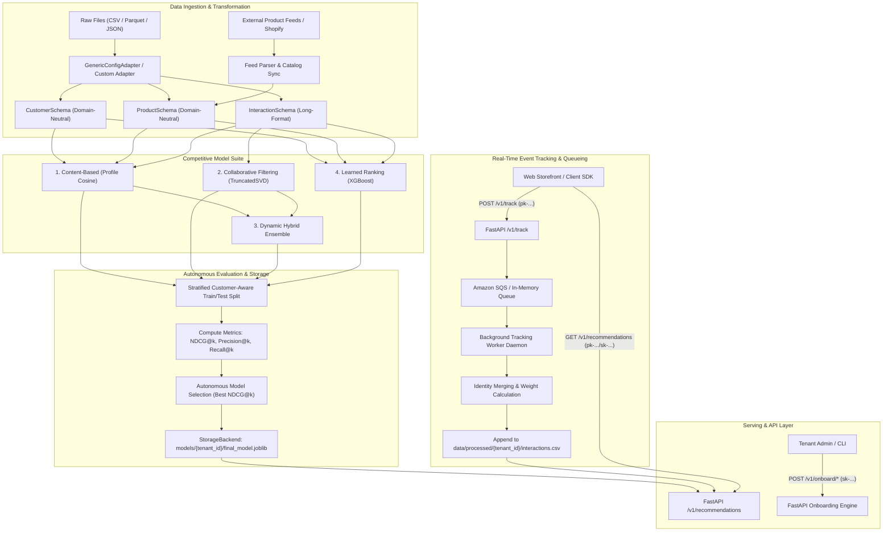
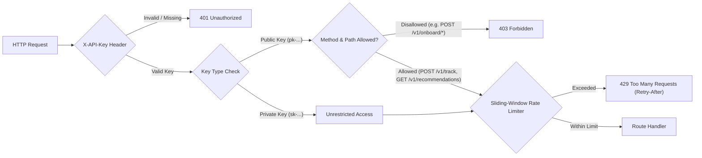
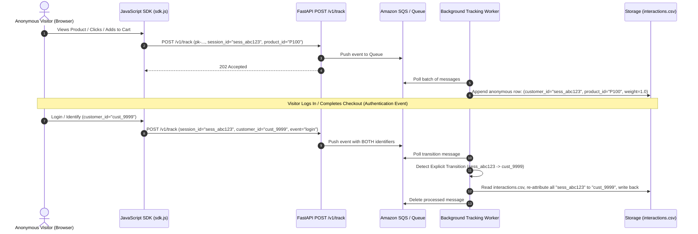

# AI_POD: Full Project Architecture, Implementation & Operation Guide

**Authoritative Technical Reference & End-to-End System Manual**  
*Project Repository: AI_POD (Multi-Tenant Recommendation Engine & Automated Onboarding Platform)*

---

## Table of Contents
1. [Executive Summary & System Vision](#1-executive-summary--system-vision)
2. [High-Level Architecture & Multi-Tenant Topology](#2-high-level-architecture--multi-tenant-topology)
3. [Core Schema Contracts & Feature Specifications (`src/core`)](#3-core-schema-contracts--feature-specifications-srccore)
4. [Data Ingestion, Adapters & Processing (`src/data`)](#4-data-ingestion-adapters--processing-srcdata)
5. [Recommendation Algorithm Suite (`src/models`)](#5-recommendation-algorithm-suite-srcmodels)
6. [Evaluation Pipeline & Autonomous Model Selection (`src/evaluation`)](#6-evaluation-pipeline--autonomous-model-selection-srcevaluation)
7. [Multi-Tenant API Serving Layer (`src/api`)](#7-multi-tenant-api-serving-layer-srcapi)
8. [Real-Time Event Ingestion, Queueing & Identity Merging (`src/queue`, `src/api/tracking`)](#8-real-time-event-ingestion-queueing--identity-merging-srcqueue-srcapitracking)
9. [Automated Dataset Onboarding & Profiling Engine (`src/onboarding`)](#9-automated-dataset-onboarding--profiling-engine-srconboarding)
10. [Catalog Feed Synchronization (`src/catalog`)](#10-catalog-feed-synchronization-srccatalog)
11. [Platform Integrations: Shopify & AWS (`src/integrations`)](#11-platform-integrations-shopify--aws-srcintegrations)
12. [Storage Abstraction: Local Filesystem & Amazon S3 (`src/storage`)](#12-storage-abstraction-local-filesystem--amazon-s3-srcstorage)
13. [Scheduled Retraining & Model Hot-Swapping (`src/scheduler`)](#13-scheduled-retraining--model-hot-swapping-srcscheduler)
14. [Client-Side JavaScript SDK (`static/sdk.js`)](#14-client-side-javascript-sdk-staticsdkjs)
15. [Interactive Demo Storefronts (`demo/`)](#15-interactive-demo-storefronts-demo)
16. [Account Management & Key Security (`src/accounts`, `src/utils/key_manager`)](#16-account-management--key-security-srcaccounts-srcutilskey_manager)
17. [Configuration Reference (`config/config.yaml`)](#17-configuration-reference-configconfigyaml)
18. [Operational CLI & Script Suite (`scripts/`)](#18-operational-cli--script-suite-scripts)
19. [Testing & Quality Assurance (`tests/`)](#19-testing--quality-assurance-tests)
20. [End-to-End Walkthroughs & Onboarding Recipes](#20-end-to-end-walkthroughs--onboarding-recipes)
21. [Production Deployment & Containerization](#21-production-deployment--containerization)

---

## 1. Executive Summary & System Vision

### 1.1 The Challenge of Domain-Tied Recommendation Systems
Traditional enterprise recommendation systems are brittle: feature extractors, candidate generation logic, rating matrices, and ranking models are hardcoded to specific table schemas and column names (e.g., `user_id`, `movie_id`, `rating`, or `tenure`, `MonthlyCharges`, `churn`). When an engineering organization seeks to support a new business unit, or when a SaaS vendor attempts to onboard a new client with different tabular or transactional data structures, the typical response is writing custom ETL scripts, rewriting model pipelines, and maintaining bespoke serving infrastructure.

### 1.2 The AI_POD Solution
**AI_POD** is a production-grade, domain-agnostic, multi-tenant recommendation platform. It completely decouples algorithmic intelligence from data schema semantics. 

Key innovations include:
- **Contract-Driven Data Normalization**: Ingests diverse industry datasets (Telecommunications, E-Commerce, Grocery Delivery, Entertainment/Streaming, SaaS) and normalizes them into domain-neutral schema contracts ([`CustomerSchema`](file:///d:/Projects/AI_POD/src/core/schema.py#L77), [`ProductSchema`](file:///d:/Projects/AI_POD/src/core/schema.py#L116), [`InteractionSchema`](file:///d:/Projects/AI_POD/src/core/schema.py#L164)).
- **Abstract Feature Specifications**: All candidate models operate on generic [`FeatureSpec`](file:///d:/Projects/AI_POD/src/core/schema.py#L67) metadata descriptions rather than concrete column identifiers.
- **Autonomous Competitive Model Selection**: Trains four disparate algorithmic paradigms simultaneously (Content-Based Cosine Profile, TruncatedSVD Collaborative Filtering, Dynamic Hybrid Rank-Blend, and Supervised XGBoost Learned Ranking), evaluates them on held-out interaction data using standardized ranking metrics (NDCG@K, Precision@K, Recall@K), and autonomously selects and persists the winning model per tenant.
- **Strict Multi-Tenant Isolation**: Complete isolation across data paths (`data/processed/{tenant_id}/`), model artifacts (`models/{tenant_id}/`), status files (`status/{tenant_id}.json`), and API key authorization (`X-API-Key`).
- **Real-Time Behavioral Tracking & Identity Merging**: Captures client interactions (views, clicks, cart additions, purchases) via Amazon SQS or local queue, applies weighted interaction signals, and seamlessly resolves anonymous browsing sessions (`session_id`) to authenticated customer identities (`customer_id`) without heuristics or privacy-invasive fingerprinting.
- **Zero-Code Automated Onboarding**: An AI-assisted profiling engine analyzes raw customer files, infers schema mappings, generates valid configuration files, and orchestrates end-to-end training automatically.

---

## 2. High-Level Architecture & Multi-Tenant Topology



### Multi-Tenant Isolation Model
Every resource in AI_POD is keyed by `tenant_id`:
1. **Raw Ingestion**: Configured per tenant in `config/config.yaml` or stored at `data/raw/{tenant_id}/`.
2. **Processed Data**: Isolated at `data/processed/{tenant_id}/customers.csv`, `products.csv`, and `interactions.csv`.
3. **Model Artifacts**: Persisted at `models/{tenant_id}/final_model.joblib`.
4. **Execution Status**: Recorded at `status/{tenant_id}.json`.
5. **API Routing**: The `X-API-Key` HTTP header resolves automatically to the tenant identifier. Cross-tenant leakage is physically prevented at the storage and memory cache layers.

---

## 3. Core Schema Contracts & Feature Specifications (`src/core`)

The foundation of AI_POD’s domain neutrality resides in [`src/core/schema.py`](file:///d:/Projects/AI_POD/src/core/schema.py) and [`src/core/encoding.py`](file:///d:/Projects/AI_POD/src/core/encoding.py).

### 3.1 Feature Specifications ([`FeatureSpec`](file:///d:/Projects/AI_POD/src/core/schema.py#L67))
A `FeatureSpec` models an arbitrary tabular attribute without binding to business semantics:
- `name: str`: Column identifier in the transformed DataFrame.
- `dtype: Literal["numeric", "categorical"]`: Data type category.
- `allowed_values: list[str] | None`: Permitted categories for categorical variables; enables strict runtime validation against unexpected or corrupt values.
- `encoding: Literal["passthrough", "one_hot"]`: Transformation strategy. Categorical variables configured with `one_hot` are automatically converted into binary indicator features.

### 3.2 Customer Contract ([`CustomerSchema`](file:///d:/Projects/AI_POD/src/core/schema.py#L77))
Defines the structure of the customer registry:
- **Primary Key**: `customer_id` (string identifier).
- **Features**: List of `FeatureSpec` objects representing demographic, behavioral, or engagement features (e.g., `tenure`, `monthly_spend`, `plan_type`, `Contract`).
- **Validation**:
  - `validate(df)`: Verifies presence of `customer_id` and all declared feature columns.
  - `validate_values(df)`: Validates that numeric columns contain purely numerical data and categoricals conform strictly to `allowed_values`.

### 3.3 Product Contract ([`ProductSchema`](file:///d:/Projects/AI_POD/src/core/schema.py#L116))
Defines the catalog items eligible for recommendation:
- **Primary Key**: `product_id` (string identifier).
- **Display Label**: `product_name` (optional human-readable title).
- **Category Spec**: `category` (optional `FeatureSpec` specifying product category, e.g., Core vs. Add-on, Electronics, Apparel).
- **Features**: List of additional item-level `FeatureSpec` attributes (price, tags, specs).

### 3.4 Interaction Contract ([`InteractionSchema`](file:///d:/Projects/AI_POD/src/core/schema.py#L164))
Defines long-format customer–product interactions:
- **Primary Keys**: `customer_id` and `product_id`.
- **Strength / Affinity**: `weight: float` (defaults to `1.0`, or weighted dynamically by event type: `purchase=5.0`, `cart=3.0`, `click=2.0`, `view=1.0`).
- **Temporal Context**: `timestamp: str | datetime` (ISO 8601 string or datetime).

### 3.5 Feature Encoding Pipeline ([`src/core/encoding.py`](file:///d:/Projects/AI_POD/src/core/encoding.py))
Provides deterministic, reusable feature transformations:
- `encode_features(df, specs)`: Transforms raw customer/product tables into purely numeric matrices. Numerical columns are scaled or passed through; categorical columns with `one_hot` are expanded into stable binary indicator columns based on `allowed_values`.
- Missing values in numeric fields are cleanly imputed (median/zero), and unseen categories are safely encoded as zeros, preventing inference crashes.

---

## 4. Data Ingestion, Adapters & Processing (`src/data`)

The ingestion layer translates heterogeneous raw data into the canonical schema contracts.

### 4.1 Base Data Adapter ([`src/data/base_adapter.py`](file:///d:/Projects/AI_POD/src/data/base_adapter.py))
An abstract base class `DataAdapter` defining the contract:
- `to_customers() -> pd.DataFrame`: Extracts and normalizes customer entities conforming to `CustomerSchema`.
- `to_products() -> pd.DataFrame`: Extracts catalog items conforming to `ProductSchema`.
- `to_interactions() -> pd.DataFrame`: Transforms usage records, transactions, or service subscriptions into `InteractionSchema`.
- `adapt() -> tuple[pd.DataFrame, pd.DataFrame, pd.DataFrame]`: Orchestrates extraction and runs strict contract validation.

### 4.2 Generic Config Adapter ([`src/data/adapters/generic_config_adapter.py`](file:///d:/Projects/AI_POD/src/data/adapters/generic_config_adapter.py))
The primary zero-code ingestion driver. Given a declarative `TenantConfig` block in YAML, `GenericConfigAdapter` loads and reshapes data without custom Python code:
1. **Raw Loading**: Supports local file paths and remote object storage (S3). Handles CSV, Parquet, and JSON formats.
2. **Customer Transformation**: Resolves the customer ID column, casts data types according to `FeatureSpec`, and applies allowed-value filters.
3. **Product Derivation**:
   - `derived_from: interaction_source`: Automatically infers product catalog rows from wide service columns or interaction matrices.
   - `derived_from: transactional`: Extracts unique product IDs and descriptions directly from transaction logs.
4. **Interaction Extraction ([`src/data/interaction_extraction.py`](file:///d:/Projects/AI_POD/src/data/interaction_extraction.py))**:
   - **Service Matrix Mode**: Pivots wide subscription records (e.g., Telco features like `OnlineSecurity`, `StreamingTV`) into normalized long-format rows based on configured `positive_values` (e.g. `['Yes', 'DSL', 'Fiber optic']`).
   - **Transactional Receipt Mode**: Groups e-commerce order rows (e.g., `InvoiceNo`, `CustomerID`, `StockCode`, `Quantity`), filters return/cancellation invoices (e.g. starting with `C`), aggregates quantities/frequencies, and normalizes interaction weights.

---

## 5. Recommendation Algorithm Suite (`src/models`)

AI_POD incorporates four distinct recommender architectures to guarantee competitive performance across sparse, dense, cold-start, and feature-rich environments.

```
                              ┌───────────────────────────────────────────────┐
                              │            Raw Tenant Data                    │
                              └──────────────────────┬────────────────────────┘
                                                     │
                                                     ▼
                              ┌───────────────────────────────────────────────┐
                              │       Normalized Schema DataFrames            │
                              │  - Customers (Features df)                    │
                              │  - Products (Catalog df)                      │
                              │  - Interactions (Long-format Matrix df)       │
                              └──────────────────────┬────────────────────────┘
                                                     │
               ┌──────────────────────────────┬──────┴───────────────────────┬──────────────────────────────┐
               │                              │                              │                              │
               ▼                              ▼                              ▼                              ▼
    ┌─────────────────────┐        ┌─────────────────────┐        ┌─────────────────────┐        ┌─────────────────────┐
    │ 1. Content-Based    │        │ 2. Collaborative    │        │ 3. Dynamic Hybrid   │        │ 4. Learned Ranking  │
    │    Profile Cosine   │        │    Filtering (SVD)  │        │    Rank Blend       │        │    (XGBoost)        │
    ├─────────────────────┤        ├─────────────────────┤        ├─────────────────────┤        ├─────────────────────┤
    │ Customer Profile    │        │ Interaction Matrix  │        │ Blends ranks from   │        │ Binary classifier   │
    │ Vector aggregated   │        │ factored into       │        │ Content-Based and   │        │ predicting item     │
    │ from taken products;│        │ latent space via    │        │ Collaborative models│        │ conversion using    │
    │ Cosine similarity   │        │ TruncatedSVD;       │        │ with fallback       │        │ customer, product,  │
    │ against catalog.    │        │ Cosine similarity   │        │ routing for cold-   │        │ and interaction     │
    │ Cold-start proof.   │        │ on latent vectors.  │        │ start visitors.     │        │ context features.   │
    └─────────────────────┘        └─────────────────────┘        └─────────────────────┘        └─────────────────────┘
```

### 5.1 Content-Based Recommender ([`src/models/content_based.py`](file:///d:/Projects/AI_POD/src/models/content_based.py))
- **Mathematical Foundation**: Builds customer affinity profiles by aggregating feature representations of products previously interacted with:
  $$\mathbf{p}_u = \frac{1}{|I_u|} \sum_{i \in I_u} \mathbf{v}_i$$
  where $\mathbf{v}_i$ is the one-hot/scaled feature vector of product $i$, and $I_u$ is the set of items customer $u$ has engaged with.
- **Scoring**: Computes cosine similarity between customer profile $\mathbf{p}_u$ and all candidate product vectors $\mathbf{v}_j$:
  $$\text{Score}(u, j) = \frac{\mathbf{p}_u \cdot \mathbf{v}_j}{\|\mathbf{p}_u\|_2 \|\mathbf{v}_j\|_2}$$
- **Strengths**: Excels during cold-start scenarios where a new customer has zero historical collaborative signals but demographic or preference attributes are known.

### 5.2 Collaborative Filtering Recommender ([`src/models/collaborative_filtering.py`](file:///d:/Projects/AI_POD/src/models/collaborative_filtering.py))
- **Mathematical Foundation**: Constructs the sparse customer-product interaction matrix $\mathbf{R} \in \mathbb{R}^{|U| \times |P|}$, where entries correspond to interaction weights or binary indicators.
- **Dimensionality Reduction**: Computes low-rank approximation via Truncated Singular Value Decomposition (TruncatedSVD):
  $$\mathbf{R} \approx \mathbf{U}_k \mathbf{\Sigma}_k \mathbf{V}_k^T$$
  Customers and products are projected into a shared $k$-dimensional latent space:
  $$\mathbf{u}_i = \mathbf{U}_{k, i} \mathbf{\Sigma}_k, \quad \mathbf{q}_j = \mathbf{V}_{k, j}$$
- **Scoring**: Ranks products by cosine similarity in the latent factor space:
  $$\text{Score}(u, j) = \frac{\mathbf{u}_i \cdot \mathbf{q}_j}{\|\mathbf{u}_i\|_2 \|\mathbf{q}_j\|_2}$$
- **Strengths**: Uncovers non-obvious latent affinities and community preferences across dense user-item interaction topologies (demonstrated by high NDCG on MovieLens).

### 5.3 Dynamic Hybrid Recommender ([`src/models/hybrid.py`](file:///d:/Projects/AI_POD/src/models/hybrid.py))
- **Mechanism**: Blends the rank positions of the Content-Based and Collaborative Filtering models:
  $$\text{Score}_{\text{hybrid}}(u, j) = w_{\text{content}} \cdot \left(K - \text{Rank}_{\text{content}}(j)\right) + w_{\text{cf}} \cdot \left(K - \text{Rank}_{\text{cf}}(j)\right)$$
- **Adaptive Fallback Routing**: If customer $u$ has zero interaction history in the collaborative matrix, the hybrid model automatically skips collaborative evaluation and routes 100% of the recommendation budget through the content-based engine.

### 5.4 Learned Ranking Model ([`src/models/ranking_model.py`](file:///d:/Projects/AI_POD/src/models/ranking_model.py))
- **Architecture**: A supervised gradient-boosted tree model powered by XGBoost (`XGBClassifier`).
- **Candidate Pair Construction**: For each customer, positive instances are products the customer took ($y=1$). Negative instances are sampled from available products not taken ($y=0$).
- **Feature Extraction Pipeline**:
  1. *Customer Features*: Demographic and behavioral attributes encoded via `FeatureSpec` (e.g., tenure, spend, plan type).
  2. *Product Features*: Catalog category, price, add-on tier encoded via `FeatureSpec`.
  3. *Interaction Context*: Total products adopted, service adoption ratio, interaction frequency.
  4. *Algorithmic Signals*: Collaborative filtering latent affinity scores and content similarity scores.
- **Optimization Objective**: Minimizes binary logistic loss or ranking objective:
  $$\mathcal{L} = -\sum_{i} \left[ y_i \log \hat{y}_i + (1 - y_i) \log(1 - \hat{y}_i) \right]$$
- **Inference**: Evaluates candidate products for customer $u$, predicts probability $\hat{y} = P(\text{Take}=1)$, and sorts by descending probability.

---

## 6. Evaluation Pipeline & Autonomous Model Selection (`src/evaluation`)

### 6.1 Customer-Aware Stratified Train/Test Split ([`src/evaluation/split.py`](file:///d:/Projects/AI_POD/src/evaluation/split.py))
Standard random row splitting introduces severe data leakage and breaks customer evaluation in recommendation tasks. AI_POD implements customer-stratified holdout splitting:
- For every customer in the interaction dataset, a maximum of $N$ interactions (default: $N=2$) are isolated into `test_interactions`.
- The remaining historical interactions form `train_interactions`.
- Customers with only 1 interaction remain in the training set to prevent empty customer profiles.
- This ensures test interactions represent genuine future prediction targets for customers observed during training.

### 6.2 Evaluation Metrics ([`src/evaluation/metrics.py`](file:///d:/Projects/AI_POD/src/evaluation/metrics.py))
Given recommended list $R_k = [r_1, r_2, \dots, r_k]$ and relevant held-out items $T$:

| Metric | Mathematical Formulation | Interpretation |
| :--- | :--- | :--- |
| **Precision@K** | $\frac{\|R_k \cap T\|}{k}$ | Fraction of top-$k$ recommendations that are relevant. |
| **Recall@K** | $\frac{\|R_k \cap T\|}{\|T\|}$ | Fraction of all relevant items captured in top-$k$. |
| **HitRate@K** | $\mathbb{I}(\|R_k \cap T\| > 0)$ | Binary indicator: was at least one relevant item recommended? |
| **DCG@K** | $\sum_{i=1}^k \frac{2^{\mathbb{I}(r_i \in T)} - 1}{\log_2(i + 1)}$ | Position-weighted utility; higher ranks rewarded logarithmically. |
| **NDCG@K** | $\frac{\text{DCG}@K}{\text{IDCG}@K}$ | Normalized Discounted Cumulative Gain against ideal ranking ($[0.0, 1.0]$). |

### 6.3 Autonomous Model Selection Workflow
Executed by [`scripts/run_pipeline.py`](file:///d:/Projects/AI_POD/scripts/run_pipeline.py#L58-L155):
1. Loads normalized tenant tables (`customers`, `products`, `interactions`).
2. Splits interactions into `train_interactions` and `test_interactions`.
3. Trains all four candidate models (`ContentBased`, `CollaborativeFiltering`, `Hybrid`, `LearnedRanking`) on the training split.
4. Generates top-$k$ recommendations ($k=5$) for each customer in the evaluation cohort.
5. Computes mean Precision@5, Recall@5, and NDCG@5 across the cohort for all four models.
6. **Selection Criteria**: Selects the algorithm achieving the highest mean NDCG@5.
7. **Retraining**: Retrains the winning algorithm on 100% of available tenant interaction data.
8. **Persistence**: Embeds customer and product catalog lookups into the winning model instance and serializes it to `models/{tenant_id}/final_model.joblib`.

### 6.4 Empirical Multi-Tenant Benchmark Proof
Documented in [`docs/generalization_proof.md`](file:///d:/Projects/AI_POD/docs/generalization_proof.md):

| Metric | Telco Default (`telco_default`) Winner: **XGBoost Ranking** | MovieLens Demo (`movielens_demo`) Winner: **Collaborative Filtering** |
| :--- | :--- | :--- |
| **NDCG@5** | **0.607** | **0.951** |
| **Precision@5** | **0.316** | **0.584** |
| **Recall@5** | **0.887** | **0.963** |
| **Dataset Scale** | $7,043$ customers, $10$ products, $20,381$ interactions | $610$ users, $14$ genre products, $7,404$ interactions |
| **Code Changes** | **Zero Python lines modified** | **Zero Python lines modified** |

---

## 7. Multi-Tenant API Serving Layer (`src/api`)

The serving tier is built on FastAPI ([`src/api/app.py`](file:///d:/Projects/AI_POD/src/api/app.py)) with complete CORS support, asynchronous request handling, and modular routers.



### 7.1 Two-Tier API Key Authentication (`src/api/auth.py`)
All requests require an `X-API-Key` HTTP header:
- **Private Keys (`sk-...`)**: Secret keys issued for backend servers, CLI tools, and administration. Permitted across all endpoints: onboarding, catalog sync, retraining, recommendations, and analytics.
- **Public Keys (`pk-...`)**: Client-side keys meant for embedding in browser HTML and the JavaScript SDK.
  - **Server-Side Enforcement**: Public keys are restricted strictly to `POST /v1/track` and `GET /v1/recommendations` (including `GET /v1/recommendations/{customer_id}`). Any attempt to access admin endpoints (`/v1/onboard/*`, `/v1/retrain/*`, `/v1/accounts/*`) results in immediate `403 Forbidden`.

### 7.2 Recommendations Endpoints (`src/api/recommendations.py`)
- `GET /v1/recommendations?customer_id=...&top_n=5`
- `POST /v1/recommendations` with JSON payload `{"customer_id": "...", "top_n": 5}`
- `GET /v1/recommendations/{customer_id}?top_n=5`

**Response Structure (`RecommendationsResponse`)**:
```json
{
  "tenant_id": "telco_default",
  "customer_id": "7590-VHVEG",
  "recommendations": [
    {
      "rank": 1,
      "product_id": "OnlineSecurity",
      "product_name": "Online Security",
      "category": "Add-on"
    },
    {
      "rank": 2,
      "product_id": "TechSupport",
      "product_name": "Tech Support",
      "category": "Add-on"
    }
  ],
  "fallback": false
}
```

### 7.3 Graceful Cold-Start Popularity Fallback
If a recommendation is requested for an unknown visitor ID, or for a tenant whose model has not yet completed training:
1. The engine avoids raising an HTTP 500 error.
2. It falls back to calculating overall product engagement popularity from the tenant's interaction history and live tracking queue.
3. It returns the top-$N$ most popular products with `"fallback": true` in the response metadata.

### 7.4 Sliding-Window Rate Limiting (`src/api/rate_limiter.py`)
A thread-safe, in-memory sliding-window rate limiter protects API resources:
- Configurable per tenant and per endpoint scope in `config.yaml` (e.g. `recommendations: 60` req/min, `onboarding: 5` req/min, `tracking: 300` req/min).
- Enforces limits based on timestamped sliding deques.
- Returns HTTP `429 Too Many Requests` with a calculated `Retry-After: <seconds>` header when exceeded.

---

## 8. Real-Time Event Ingestion, Queueing & Identity Merging (`src/queue`, `src/api/tracking`)



### 8.1 Tracking Ingestion (`src/api/tracking.py`)
- Endpoint: `POST /v1/track`
- Authenticated exclusively with public keys (`pk-...`).
- Accepts JSON events conforming to `TrackEventRequest`:
  - `event_type`: `"view" | "click" | "add_to_cart" | "purchase"`
  - `product_id`: Target product identifier.
  - `session_id`: Client browser anonymous session UUID.
  - `customer_id`: Optional authenticated customer ID.
  - `metadata`: Arbitrary JSON dictionary (price, cart total, referrer).
- Validates payload structure and returns HTTP `202 Accepted` immediately.

### 8.2 Amazon SQS Integration (`src/queue/tracking_queue.py`)
- Pushes events to Amazon SQS (`ai-pod-tracking-events`).
- **Resilience**: If AWS credentials or network connections are unavailable, events are captured in an in-memory queue fallback without interrupting client traffic.

### 8.3 Background Tracking Worker (`src/queue/tracking_worker.py`)
A continuous worker daemon that:
1. Long-polls SQS for batches of up to 10 messages (`WaitTimeSeconds=10`).
2. Computes interaction weights based on event action:
   - `purchase`: Weight $5.0$
   - `add_to_cart`: Weight $3.0$
   - `click`: Weight $2.0$
   - `view`: Weight $1.0$
3. Batches writes to `data/processed/{tenant_id}/interactions.csv`.

### 8.4 Identity Merging Architecture
AI_POD avoids probabilistic device fingerprinting or IP heuristics, which frequently misattribute distinct users on shared Wi-Fi networks. Instead, it enforces **Deterministic Transition Detection**:
1. When an incoming event carries *both* a `session_id` and a recognized `customer_id` (e.g., login, registration, authenticated checkout), an identity transition is flagged.
2. The worker loads the tenant's stored interactions and replaces all occurrences of `session_id` with `customer_id`.
3. Historical browsing, click, and cart actions performed while anonymous are immediately consolidated into the customer's permanent recommendation profile.

---

## 9. Automated Dataset Onboarding & Profiling Engine (`src/onboarding`)

AI_POD features an automated ingestion engine that eliminates manual schema writing.

### 9.1 Dataset Profiler ([`src/onboarding/profiler.py`](file:///d:/Projects/AI_POD/src/onboarding/profiler.py))
Inspects raw CSV or Parquet files and computes:
- Row and column counts.
- Candidate ID columns (uniqueness ratio $> 0.95$, string/integer patterns like `user_id`, `customer_id`, `id`).
- Interaction type classification:
  - *Transactional Receipts*: Multiple rows per customer, order timestamps, quantities, product descriptions.
  - *Service Matrix*: Single row per customer, multiple binary/categorical service columns (`Yes`/`No`, `DSL`/`Fiber`).
- Candidate product columns (`StockCode`, `product_id`, `item_id`).
- Feature distributions, missingness percentages, and distinct value sets for categorical attributes.

### 9.2 Configuration Generator ([`src/onboarding/config_generator.py`](file:///d:/Projects/AI_POD/src/onboarding/config_generator.py))
Transforms profiler outputs into a syntactically valid `TenantConfig` block:
- Automatically maps ID columns and sets data types.
- Sets `one_hot` encoding for low-cardinality categoricals ($2 \le \text{cardinality} \le 20$).
- Generates `InteractionSourceConfig` with appropriate positive/negative mappings or transactional groupings.
- Automatically validates the generated configuration using Pydantic and schema assertions.

### 9.3 Self-Service Onboarding API & UI ([`src/api/onboarding.py`](file:///d:/Projects/AI_POD/src/api/onboarding.py), [`demo/onboarding.html`](file:///d:/Projects/AI_POD/demo/onboarding.html))
- `POST /v1/onboard/upload`: Uploads a raw data file and returns automated profiling heuristics.
- `POST /v1/onboard/validate`: Validates proposed schema mappings and overrides.
- `POST /v1/onboard/confirm`: Writes the new tenant block to `config/config.yaml` and provisions tenant directories.
- `POST /v1/onboard/train`: Initiates training in a background daemon thread.
- `GET /v1/onboard/status`: Polls real-time training progress (`pending`, `running`, `ready_to_train`, `completed`, `failed`).

---

## 10. Catalog Feed Synchronization (`src/catalog`)

To ensure product metadata and prices stay synchronized with external catalogs:

### 10.1 Feed Parser ([`src/catalog/feed_parser.py`](file:///d:/Projects/AI_POD/src/catalog/feed_parser.py))
Parses incoming external product catalogs from diverse formats:
- **Google Merchant Center XML**: Standard `<rss>` and `<feed>` specifications parsing `<g:id>`, `<g:title>`, `<g:price>`, `<g:product_type>`.
- **JSON Product Feeds**: Arrays or dictionaries of product records.
- **CSV Feeds**: Tabular item exports.

### 10.2 Synchronization Engine ([`src/catalog/feed_sync.py`](file:///d:/Projects/AI_POD/src/catalog/feed_sync.py))
- Supports two synchronization modes:
  - `upsert`: Updates existing products by `product_id` and appends newly discovered items while preserving historical items.
  - `replace`: Replaces the product catalog entirely with the incoming feed.
- Writes normalized catalog rows directly to `data/processed/{tenant_id}/products.csv` via the active `StorageBackend`.

---

## 11. Platform Integrations: Shopify & AWS (`src/integrations`)

### 11.1 Shopify App Integration ([`src/integrations/shopify/`](file:///d:/Projects/AI_POD/src/integrations/shopify/))
Enables instant, one-click integration for Shopify merchants:
- **OAuth 2.0 Flow** ([`api.py`](file:///d:/Projects/AI_POD/src/integrations/shopify/api.py)):
  - Generates secure authorization URLs with state tokens.
  - Verifies HMAC signatures on callbacks using the Shopify client secret.
  - Exchanges authorization codes for permanent offline access tokens.
- **Admin GraphQL / REST Client** ([`client.py`](file:///d:/Projects/AI_POD/src/integrations/shopify/client.py)):
  - Fetches complete product catalogs, prices, collections, and image URLs.
  - Ingests historical orders to bootstrap customer interaction history.
- **Webhook Handlers**: Listens for `products/create`, `products/update`, `orders/create` to maintain real-time catalog and interaction synchronization.

### 11.2 AWS Integrations ([`src/integrations/aws/`](file:///d:/Projects/AI_POD/src/integrations/aws/))
- **Amazon EventBridge** ([`eventbridge.py`](file:///d:/Projects/AI_POD/src/integrations/aws/eventbridge.py)): Manages scheduled rules (e.g. `cron(0 2 * * ? *)`) to trigger nightly batch retraining without manual intervention.
- **Amazon SQS**: High-throughput queueing for client tracking events.
- **Amazon S3**: Scalable cloud object storage for datasets and trained model binaries.

---

## 12. Storage Abstraction: Local Filesystem & Amazon S3 (`src/storage`)

AI_POD provides a storage abstraction ([`StorageBackend`](file:///d:/Projects/AI_POD/src/storage/base_storage.py)) allowing the entire system to run seamlessly in local development or in AWS cloud deployments with zero code changes.

### 12.1 Storage Contract Methods
- `read_file(path: str) -> bytes`: Reads raw bytes from path.
- `write_file(path: str, content: bytes) -> None`: Writes byte content, creating parent prefixes automatically.
- `exists(path: str) -> bool`: Checks existence.
- `list_files(prefix: str) -> list[str]`: Enumerates keys matching prefix.

### 12.2 Local Storage ([`src/storage/local_storage.py`](file:///d:/Projects/AI_POD/src/storage/local_storage.py))
Reads and writes directly to the local filesystem relative to the project root. Ideal for unit tests, local debugging, and single-server deployments.

### 12.3 Amazon S3 Storage ([`src/storage/s3_storage.py`](file:///d:/Projects/AI_POD/src/storage/s3_storage.py))
Connects to Amazon S3 via `boto3`:
- Stores datasets and model binaries under `s3://<bucket>/<prefix>/...`.
- Transparently handles multipart uploads and byte streaming.
- Preserves identical logical paths (`data/processed/{tenant_id}/...`) across backends.

---

## 13. Scheduled Retraining & Model Hot-Swapping (`src/scheduler`)

As customers interact with products, models must adapt to behavioral drift without service interruptions.

### 13.1 Training Readiness Checker ([`src/scheduler/readiness_checker.py`](file:///d:/Projects/AI_POD/src/scheduler/readiness_checker.py))
Inspects tenant storage to verify eligibility:
- Ensures customer count $\ge \text{min\_customers\_to\_train}$ (default: $50$).
- Ensures interaction count $\ge \text{min\_interactions\_to\_train}$ (default: $200$).
- Verifies catalog consistency and flags untrained vs. existing tenants.

### 13.2 Retrain Orchestrator ([`src/scheduler/retrain_orchestrator.py`](file:///d:/Projects/AI_POD/src/scheduler/retrain_orchestrator.py))
- Discovers all registered tenants across `config.yaml` and storage prefixes.
- **Collision Prevention**: Inspects `_ACTIVE_TRAINING_THREADS` to skip tenants currently undergoing training.
- Launches background retraining runs incorporating all newly ingested interactions.
- **Zero-Downtime Hot-Swapping**: The new model artifact is written to storage; once serialized, the in-memory cache `MODEL_CACHE[tenant_id]` is atomically cleared and reloaded. In-flight API requests are never dropped or blocked.

---

## 14. Client-Side JavaScript SDK (`static/sdk.js`)

A lightweight ($< 25\text{ KB}$ unminified), dependency-free client snippet designed for drop-in inclusion on e-commerce storefronts.

### 14.1 Installation & Configuration
```html
<script 
  src="https://api.your-engine.com/v1/sdk.js" 
  data-tenant-key="pk_live_your_public_key">
</script>
```

### 14.2 Session Persistence Architecture
- **Primary Persistence**: `localStorage`. Origin-scoped, provides $5\text{MB}$ capacity, does not expire upon browser closing, and avoids sending large cookies with every static asset HTTP request.
- **Secondary Fallback**: First-Party Cookie (`aipod_session_id=...; SameSite=Lax; max-age=31536000`). Used when `localStorage` is blocked by iframe sandboxes or security policies.
- **In-Memory Buffer**: Guarantees zero runtime crashes if both storage APIs are disabled.

### 14.3 Automated & Programmatic Tracking API
```javascript
// Automatically track page view
aipod.track('view', { product_id: 'SKU-1001' });

// Track click or interaction
aipod.track('click', { product_id: 'SKU-1001' });

// Track add-to-cart
aipod.track('add_to_cart', { product_id: 'SKU-1001', price: 29.99 });

// Track conversion / purchase
aipod.track('purchase', { product_id: 'SKU-1001', order_id: 'ORD-9821' });

// Identify customer upon login
aipod.identify('cust_48201');
```

### 14.4 Dynamic Recommendation Rendering Widget
```javascript
// Fetch and render top-4 recommendations into a DOM container
aipod.getRecommendations({
  top_n: 4,
  containerId: 'recommended-products-grid',
  template: function(item) {
    return '<div class="product-card">' +
             '<h4>' + item.product_name + '</h4>' +
             '<span class="category">' + item.category + '</span>' +
           '</div>';
  }
});
```

---

## 15. Interactive Demo Storefronts (`demo/`)

The repository includes complete, interactive web storefronts demonstrating real-time personalization across industries:

1. [`demo/storefront.html`](file:///d:/Projects/AI_POD/demo/storefront.html): General E-Commerce Storefront showcasing dynamic product grids, real-time recommendation updates, and cart integration.
2. [`demo/instacart_grocery.html`](file:///d:/Projects/AI_POD/demo/instacart_grocery.html): Grocery delivery interface demonstrating category-based filtering, quick-add baskets, and personalized "Buy Again" recommendations.
3. [`demo/hm_fashion.html`](file:///d:/Projects/AI_POD/demo/hm_fashion.html): Apparel and fashion retail portal demonstrating aesthetic personalization, size selection, and complete-the-look suggestions.
4. [`demo/telco_portal.html`](file:///d:/Projects/AI_POD/demo/telco_portal.html): Subscription portal demonstrating add-on package recommendations (Tech Support, Streaming TV, Online Security) based on customer contract and tenure.
5. [`demo/onboarding.html`](file:///d:/Projects/AI_POD/demo/onboarding.html): Visual, wizard-style tenant onboarding portal allowing users to upload datasets, inspect data profiles, adjust column mappings, and trigger training runs.
6. [`demo/test_sdk.html`](file:///d:/Projects/AI_POD/demo/test_sdk.html): Developer diagnostic workbench for testing SDK event delivery, queue polling, and recommendation responses.

---

## 16. Account Management & Key Security (`src/accounts`, `src/utils/key_manager`)

### 16.1 Account Service ([`src/accounts/service.py`](file:///d:/Projects/AI_POD/src/accounts/service.py))
- **Company Registration**: Validates email format, enforces strong password constraints ($\ge 8$ characters), and securely hashes credentials using `bcrypt` with salt.
- **Slugified Tenant IDs**: Automatically derives URL-safe, unique tenant IDs from company names (e.g. `"Acme Corp"` $\to$ `"acme_corp"`, resolving duplicates via numeric suffixes).
- **Unique Account IDs**: Generates cryptographically secure account IDs (`acc_xxxxxxxx`).

### 16.2 Key Generation & Rotation ([`src/utils/key_manager.py`](file:///d:/Projects/AI_POD/src/utils/key_manager.py))
- Generates cryptographically random 32-character tokens:
  - Private: `sk-live-<random_hex>`
  - Public: `pk-live-<random_hex>`
- Stores records in `config/tenants_auth.yaml` or AWS Systems Manager (SSM) Parameter Store.
- Supports instantaneous key rotation without disrupting other active tenants.

---

## 17. Configuration Reference (`config/config.yaml`)

Below is an annotated reference configuration illustrating all supported options:

```yaml
# Storage Backend: 'local' for filesystem, 's3' for AWS S3
storage:
  backend: local          # Options: local | s3
  s3_bucket: null         # S3 bucket name when backend is 's3'
  s3_prefix: ''           # Root prefix inside bucket

# Ingestion Queue Configuration
tracking:
  queue_name: ai-pod-tracking-events
  queue_url: null         # Resolved dynamically or specified explicitly

# Retraining Thresholds
training:
  min_customers_to_train: 50
  min_interactions_to_train: 200

# EventBridge Nightly Retrain Schedule
eventbridge:
  rule_name: ai-pod-nightly-retrain
  schedule_expression: cron(0 2 * * ? *)
  state: ENABLED

# Tenant Registry
tenants:
  # Example Tenant A: Subscription Matrix Dataset
  telco_default:
    data_source:
      type: csv
      path: data/raw/telco_customer_churn.csv
    customers:
      id_column: customerID
      features:
        - name: tenure
          dtype: numeric
        - name: MonthlyCharges
          dtype: numeric
        - name: Contract
          dtype: categorical
          allowed_values: ["Month-to-month", "One year", "Two year"]
          encoding: one_hot
    products:
      derived_from: interaction_source
      category_column: category
    interactions:
      source: interaction_source
      service_columns: ["OnlineSecurity", "TechSupport", "StreamingTV"]
      positive_values: ["Yes", "DSL", "Fiber optic"]
      negative_values: ["No", "No internet service"]
    rate_limit:
      recommendations: 60
      onboarding: 5

  # Example Tenant B: E-Commerce Transactional Log
  online_retail:
    data_source:
      type: csv
      path: data/raw/online_retail.csv
    customers:
      id_column: CustomerID
      features:
        - name: Country
          dtype: categorical
          encoding: one_hot
    products:
      derived_from: transactional
      id_column: StockCode
      name_column: Description
    interactions:
      source: transactional
      customer_id_column: CustomerID
      product_id_column: StockCode
      product_name_column: Description
      quantity_column: Quantity
      transaction_id_column: InvoiceNo
      exclude_invoice_prefix: C
    rate_limit:
      recommendations: 120
      onboarding: 5
```

---

## 18. Operational CLI & Script Suite (`scripts/`)

The repository provides 17 command-line utilities for all administrative and operational workflows:

| Script | Purpose & Usage Example |
| :--- | :--- |
| [`run_pipeline.py`](file:///d:/Projects/AI_POD/scripts/run_pipeline.py) | **End-to-end pipeline**: ingests data, trains all 4 models, evaluates metrics, selects winner, persists artifact.<br>`python scripts/run_pipeline.py --tenant_id telco_default` |
| [`train_model.py`](file:///d:/Projects/AI_POD/scripts/train_model.py) | Trains and saves a specific model for a tenant.<br>`python scripts/train_model.py --tenant_id movielens_demo` |
| [`get_recommendations.py`](file:///d:/Projects/AI_POD/scripts/get_recommendations.py) | Generates top-$N$ recommendations via CLI.<br>`python scripts/get_recommendations.py --tenant_id telco_default --customer_id 7590-VHVEG --top_n 5` |
| [`evaluate_models.py`](file:///d:/Projects/AI_POD/scripts/evaluate_models.py) | Evaluates candidate algorithms on holdout data and prints metric tables.<br>`python scripts/evaluate_models.py --tenant_id telco_default` |
| [`generate_evaluation_results.py`](file:///d:/Projects/AI_POD/scripts/generate_evaluation_results.py) | Generates markdown evaluation benchmarks and multi-tenant generalization proofs.<br>`python scripts/generate_evaluation_results.py` |
| [`onboard_tenant.py`](file:///d:/Projects/AI_POD/scripts/onboard_tenant.py) | Interactive CLI wizard for profiling a dataset and generating tenant config blocks.<br>`python scripts/onboard_tenant.py --file data/raw/my_data.csv --tenant_id my_store` |
| [`check_training_readiness.py`](file:///d:/Projects/AI_POD/scripts/check_training_readiness.py) | Checks if a tenant meets interaction and customer volume thresholds.<br>`python scripts/check_training_readiness.py --tenant_id telco_default` |
| [`run_tracking_worker.py`](file:///d:/Projects/AI_POD/scripts/run_tracking_worker.py) | Starts the background SQS tracking ingestion worker daemon.<br>`python scripts/run_tracking_worker.py` |
| [`sync_catalog_feeds.py`](file:///d:/Projects/AI_POD/scripts/sync_catalog_feeds.py) | Fetches and syncs external Google Shopping or Shopify product feeds.<br>`python scripts/sync_catalog_feeds.py --tenant_id online_retail` |
| [`issue_tenant_keys.py`](file:///d:/Projects/AI_POD/scripts/issue_tenant_keys.py) | Generates and assigns new public and private API keys.<br>`python scripts/issue_tenant_keys.py --tenant_id new_tenant` |
| [`run_scheduled_retrain.py`](file:///d:/Projects/AI_POD/scripts/run_scheduled_retrain.py) | Retrains all eligible tenants based on fresh interactions.<br>`python scripts/run_scheduled_retrain.py` |
| [`setup_eventbridge_rule.py`](file:///d:/Projects/AI_POD/scripts/setup_eventbridge_rule.py) | Provisions the nightly AWS EventBridge cron rule.<br>`python scripts/setup_eventbridge_rule.py` |
| [`download_movielens.py`](file:///d:/Projects/AI_POD/scripts/download_movielens.py) | Downloads and prepares the MovieLens benchmark dataset.<br>`python scripts/download_movielens.py` |
| [`prepare_online_retail.py`](file:///d:/Projects/AI_POD/scripts/prepare_online_retail.py) | Prepares and validates the Online Retail transactional dataset.<br>`python scripts/prepare_online_retail.py` |

---

## 19. Testing & Quality Assurance (`tests/`)

AI_POD maintains a comprehensive test suite of **46 test modules** executing over 250 test cases:

- **Unit Testing**:
  - `test_config_schema.py`: Verifies Pydantic configuration schemas and validation constraints.
  - `test_content_based.py`, `test_ranking_model.py`: Validates model fit, predict, and shape properties.
  - `test_metrics.py`, `test_split.py`: Asserts correctness of NDCG, Precision, Recall, and stratified customer splitting.
  - `test_rate_limiter.py`: Validates sliding-window enforcement and HTTP 429 response generation.
- **Integration & Security Testing**:
  - `test_api_auth.py`: Tests API key lookup, key generation, and verifies that public keys are strictly prevented from reaching admin endpoints.
  - `test_api_multitenancy.py`: Verifies catalog and model isolation between distinct tenant headers.
  - `test_fallback_and_readiness.py`: Tests popularity fallback paths for cold-start and untrained tenants.
  - `test_tracking_worker.py`: Tests SQS polling, event weighting, batching, and identity transition merging.
  - `test_storage.py`, `test_pipeline_s3_e2e.py`: Tests mock S3 operations and local filesystem parity.
- **End-to-End Generalization Regression**:
  - `test_generic_adapter_matches_telco.py`: Confirms declarative config adapters output bit-for-bit identical tables to custom Python adapters.
  - `test_movielens_tenant.py`: End-to-end test verifying multi-tenant onboarding on entertainment data.
  - `test_transactional_interactions.py`: Tests receipt grouping, cancellation filtering, and weight aggregation on retail data.

**Running the Test Suite**:
```bash
pytest tests/ -v
```

---

## 20. End-to-End Walkthroughs & Onboarding Recipes

### Walkthrough A: Adding a New E-Commerce Tenant in 3 Steps (Config-Only)

#### Step 1: Place Raw Data File
Place the transaction CSV at `data/raw/fashion_boutique.csv`.

#### Step 2: Add Tenant Block to `config/config.yaml`
```yaml
tenants:
  fashion_boutique:
    data_source:
      type: csv
      path: data/raw/fashion_boutique.csv
    customers:
      id_column: user_id
      features:
        - name: country
          dtype: categorical
          encoding: one_hot
    products:
      derived_from: transactional
      id_column: sku
      name_column: item_title
    interactions:
      source: transactional
      customer_id_column: user_id
      product_id_column: sku
      quantity_column: qty
      transaction_id_column: order_number
      exclude_invoice_prefix: RET
```

#### Step 3: Run Ingestion, Model Competition & Serving
```bash
# 1. Run pipeline: adapts data, trains 4 models, picks top NDCG@5 winner
python scripts/run_pipeline.py --tenant_id fashion_boutique

# 2. Issue API keys
python scripts/issue_tenant_keys.py --tenant_id fashion_boutique

# 3. Retrieve recommendations immediately via CLI or API
python scripts/get_recommendations.py --tenant_id fashion_boutique --customer_id U1001 --top_n 5
```

---

## 21. Production Deployment & Containerization

### 21.1 Docker Containerization ([`Dockerfile`](file:///d:/Projects/AI_POD/Dockerfile))
AI_POD is packaged as an optimized, multi-tenant container image:

```dockerfile
FROM python:3.11-slim

WORKDIR /app

RUN apt-get update && apt-get install -y --no-install-recommends \
    build-essential curl && \
    rm -rf /var/lib/apt/lists/*

COPY requirements-prod.txt requirements.txt ./
RUN pip install --no-cache-dir -r requirements.txt

COPY . .

EXPOSE 8000

ENV ENABLE_TRACKING_WORKER=true

CMD ["uvicorn", "src.api.app:app", "--host", "0.0.0.0", "--port", "8000"]
```

### 21.2 Environment Variables
| Variable | Description | Default |
| :--- | :--- | :--- |
| `STORAGE_BACKEND` | Storage provider (`local` or `s3`) | `local` |
| `S3_BUCKET` | Target AWS S3 bucket name | `null` |
| `AWS_REGION` | AWS Region for S3, SQS, and EventBridge | `us-east-1` |
| `TRACKING_QUEUE_URL` | Amazon SQS tracking queue URL | `null` |
| `ENABLE_TRACKING_WORKER` | Starts background tracking worker within API process | `false` |
| `TENANT_ID` | Default tenant fallback for CLI commands | `telco_default` |

### 21.3 Launching the API Server
```bash
# Local development with auto-reload
uvicorn src.api.app:app --host 0.0.0.0 --port 8000 --reload

# Production execution
uvicorn src.api.app:app --host 0.0.0.0 --port 8000 --workers 4
```

### 21.4 Verification Health Check
```bash
curl http://localhost:8000/
# Returns: {"message": "AI_POD Recommendation API", "docs": "/docs"}
```

---

*This document serves as the single source of truth for the architecture, implementation, mathematical models, API contracts, and operational execution of AI_POD.*
