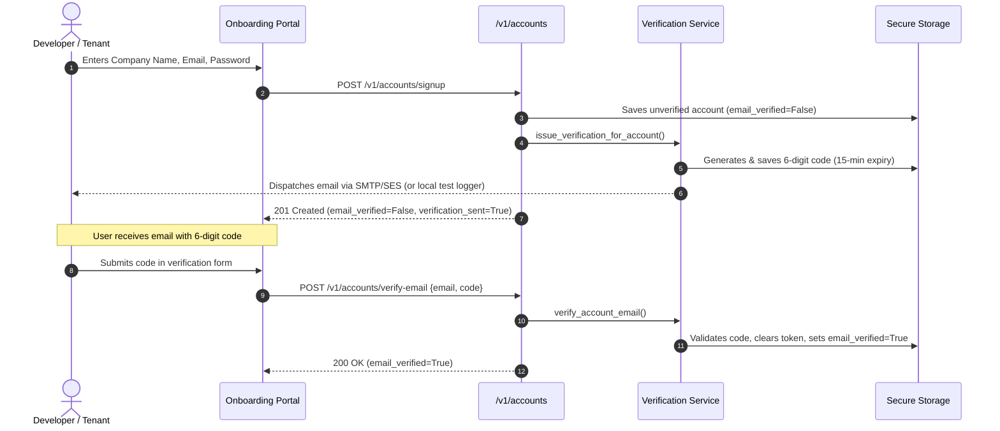
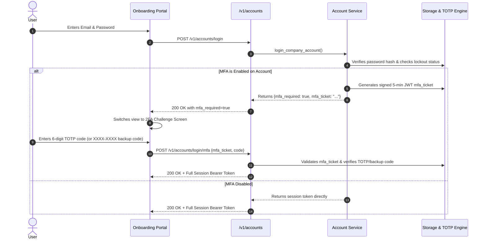

# AI POD Authentication Hardening & Security Implementation Report

**Document Version:** 1.0  
**Date:** October 29, 2026  
**Status:** Implemented & Verified (22/22 Tests Passing, 0 Warnings)  
**Author:** AI POD Engineering Team  

---

## 1. Executive Summary

Prior to this implementation, the AI POD onboarding and accounts system suffered from critical authentication vulnerabilities:
1. **Unverified Registration:** Any actor could register with arbitrary, disposable, or hijacked email addresses, immediately provisioning isolated tenant workspaces and issuing production-ready private API keys (`sk-...`) without proving identity or domain ownership.
2. **Single-Factor Dependency:** Account login relied strictly on a static password without Multi-Factor Authentication (MFA), leaving administrative tenant controls vulnerable to phishing, credential stuffing, and dictionary attacks.
3. **Absence of Account-Level Lockout:** Brute-force protection was restricted to client IP rate limiting, which could be bypassed using distributed botnets or proxy pools.
4. **Mock Key Bypass in Production:** Wildcard test keys (`sk-*-xxxx` and `pk-*-xxxx`) could be accepted without cryptographic validation.

This document details the complete architectural redesign and implementation that bundled **Email Verification**, **RFC 6238 TOTP Multi-Factor Authentication (2FA)**, **Account-Level Lockout Defense**, **Production Key Isolation**, and **Frontend Onboarding UI Integration** into a cohesive, production-grade security architecture.

---

## 2. Threat Model & Vulnerability Analysis

| Vulnerability | Attack Vector | Mitigating Implementation |
| :--- | :--- | :--- |
| **Unverified Email Signup** | Adversary registers competitor or victim domains; consumes cloud compute and generates unlimited API keys. | Cryptographic 6-digit confirmation codes + 32-byte tokens; email verification gate (`/v1/accounts/verify-email`) with optional strict login enforcement (`ENFORCE_EMAIL_VERIFICATION`). |
| **Credential Stuffing / Stolen Passwords** | Attacker uses leaked password lists to access company accounts, export customer data, or regenerate keys. | RFC 6238 TOTP Second-Factor Authentication with Authenticator App pairing + single-use hashed recovery backup codes. |
| **Distributed Brute-Force** | Rotating botnet IPs bypass IP-level rate limiters to guess user passwords. | Account-level lockout: 5 consecutive failed attempts lock the targeted account for 15 minutes, independent of source IP. |
| **Test Key Exposure** | Attacker probes API with `sk-<tenant>-xxxx` to authenticate as arbitrary tenants. | Explicit environment check (`ENV=production` / `AI_POD_ENV=production`) strictly blocking all `-xxxx` wildcard keys with `401 Unauthorized`. |

---

## 3. Architecture & Authentication Flows

### 3.1. Registration & Email Verification Flow



### 3.2. Two-Factor Authentication (MFA) Login Flow



---

## 4. Implementation Details

### 4.1. Email Verification Module ([`src/accounts/verification.py`](file:///d:/Projects/AI_POD/src/accounts/verification.py))
- **Cryptographic Generation:** Uses `secrets.randbelow()` to create unpredictable 6-digit codes and `secrets.token_urlsafe(32)` for URL activation tokens.
- **Brute-Force Guard:** Implements a 10-attempt threshold per verification token to prevent online guessing of 6-digit codes.
- **Expiration Policy:** Tokens expire after 15 minutes.
- **Dispatch Adapter:** Integrates with standard Python `smtplib` when `SMTP_HOST` is configured, with seamless fallback to in-memory audit logs (`RECENT_VERIFICATION_EMAILS`) for local and CI/CD testing.

### 4.2. RFC 6238 TOTP Engine ([`src/accounts/totp.py`](file:///d:/Projects/AI_POD/src/accounts/totp.py))
- **Standard TOTP Algorithm:** Native implementation using Python's `hmac`, `hashlib.sha1`, and `struct` conforming strictly to RFC 6238 (30-second timestep, 6 digits).
- **Drift Tolerance:** Window parameter ($\pm 1$ timestep) accounts for up to 30 seconds of client/server clock divergence.
- **Standard URI Generation:** Formats `otpauth://totp/AI%20POD:{email}?secret={secret}&issuer=AI%20POD` for instant compatibility with Google Authenticator, 1Password, and Authy.
- **Recovery Backup Codes:** Issues 8 single-use formatted codes (`XXXX-XXXX`) derived from unambiguous characters (`A-Z`, `2-9`). Codes are stored as SHA-256 hashes and permanently removed once consumed.

### 4.3. Session Token & MFA Ticket Isolation ([`src/accounts/session.py`](file:///d:/Projects/AI_POD/src/accounts/session.py))
- **Token Separation:** `create_mfa_ticket()` issues signed JWTs with `token_type: "mfa_challenge"` and a 300-second expiration.
- **Authorization Guard:** `verify_session_token()` explicitly rejects any token with `token_type: "mfa_challenge"`, preventing attackers from using intermediate MFA tickets to access protected API endpoints (`/v1/accounts/me`, `/v1/accounts/keys/regenerate`).

### 4.4. Accounts Service Logic ([`src/accounts/service.py`](file:///d:/Projects/AI_POD/src/accounts/service.py))
- **Account Lockout:** Tracks `failed_login_attempts`. At 5 failures, sets `locked_until` to `now + 15 minutes` and raises `AccountLockedError` (HTTP 423). Successful login resets the counter to 0.
- **Email Verification Check:** When `ENFORCE_EMAIL_VERIFICATION=true`, login is halted with `EmailNotVerifiedError` (HTTP 403).
- **Lifecycle Methods:**
  - `setup_account_mfa(account_id)`: Generates and records pending TOTP secret.
  - `enable_account_mfa(account_id, code)`: Verifies code against pending secret, activates MFA, and generates 8 hashed backup codes.
  - `disable_account_mfa(account_id, password, code)`: Requires password + TOTP/backup code to deactivate 2FA.
  - `login_mfa_verify(mfa_ticket, code)`: Validates ticket and code, consuming backup codes if utilized.

### 4.5. Production API Key Isolation ([`src/api/auth.py`](file:///d:/Projects/AI_POD/src/api/auth.py))
- Added immediate pre-check in `get_key_record()`:
  ```python
  is_prod = os.environ.get("ENV", "").lower() in ("production", "prod") or os.environ.get("AI_POD_ENV", "").lower() in ("production", "prod")
  if is_prod and api_key.endswith("-xxxx"):
      return None
  ```
- Ensures test fixture bypasses cannot be exploited in production deployments.

### 4.6. Onboarding Portal UI ([`demo/onboarding.html`](file:///d:/Projects/AI_POD/demo/onboarding.html))
- **Email Verification Form (`#authVerifyEmailView`):** Displays target email, code input, resend button, and validation feedback.
- **2FA Challenge Form (`#authMfaChallengeView`):** Dedicated prompt for 6-digit TOTP or 8-character backup recovery code.
- **Dashboard Security Widget:** Added a "Two-Factor Authentication (2FA)" panel in `#authDashboardView` featuring:
  - Live status badge (`Active (2FA Protected)` vs `Disabled`).
  - Modal to reveal secret key with single-click clipboard copying.
  - Test activation code input.
  - Secure display box for generated backup recovery codes.

---

## 5. API Reference & Endpoints

### 5.1. Authentication & Lifecycle Endpoints

#### `POST /v1/accounts/signup`
Creates an account and issues an email verification code.
- **Request:**
  ```json
  {
    "company_name": "Acme Corp",
    "email": "dev@acme.com",
    "password": "StrongSecretPassword123!"
  }
  ```
- **Response (201 Created):**
  ```json
  {
    "account_id": "acc_8f2k1x",
    "tenant_id": "acme_corp",
    "company_name": "Acme Corp",
    "email": "dev@acme.com",
    "email_verified": false,
    "verification_sent": true,
    "private_key": "sk-acme_corp-xxxxxxxx",
    "public_key": "pk-acme_corp-xxxxxxxx"
  }
  ```

#### `POST /v1/accounts/verify-email`
Verifies account email ownership.
- **Request:**
  ```json
  {
    "email": "dev@acme.com",
    "code": "481920"
  }
  ```
- **Response (200 OK):**
  ```json
  {
    "account_id": "acc_8f2k1x",
    "tenant_id": "acme_corp",
    "email": "dev@acme.com",
    "email_verified": true,
    "already_verified": false,
    "message": "Email successfully verified."
  }
  ```

#### `POST /v1/accounts/resend-verification`
Dispatches a new verification code.
- **Request:**
  ```json
  {
    "email": "dev@acme.com"
  }
  ```
- **Response (200 OK):**
  ```json
  {
    "email": "dev@acme.com",
    "verification_sent": true,
    "message": "Verification code has been dispatched."
  }
  ```

#### `POST /v1/accounts/login`
Authenticates credentials.
- **Standard Response (200 OK - No 2FA):**
  ```json
  {
    "access_token": "eyJhbGciOi...",
    "session_token": "eyJhbGciOi...",
    "token_type": "bearer",
    "expires_in": 3600,
    "account_id": "acc_8f2k1x",
    "tenant_id": "acme_corp",
    "mfa_required": false
  }
  ```
- **MFA Challenge Response (200 OK - 2FA Active):**
  ```json
  {
    "mfa_required": true,
    "mfa_ticket": "eyJhbGciOi... (expires in 300s)",
    "expires_in": 300,
    "account_id": "acc_8f2k1x",
    "tenant_id": "acme_corp"
  }
  ```
- **Error Responses:**
  - `401 Unauthorized`: Invalid credentials.
  - `403 Forbidden`: Email unverified (when `ENFORCE_EMAIL_VERIFICATION=true`).
  - `423 Locked`: Account temporarily locked due to 5 failed attempts.

#### `POST /v1/accounts/login/mfa`
Completes second-factor challenge.
- **Request:**
  ```json
  {
    "mfa_ticket": "eyJhbGciOi...",
    "code": "582910"
  }
  ```
- **Response (200 OK):** Returns full session token.

### 5.2. Two-Factor Authentication Management

#### `POST /v1/accounts/mfa/setup`
*(Requires Session Bearer Token)*  
Generates TOTP secret and QR URL.
- **Response (200 OK):**
  ```json
  {
    "account_id": "acc_8f2k1x",
    "secret": "JBSWY3DPEHPK3PXPJBSWY3DPEHPK3PXP",
    "otpauth_url": "otpauth://totp/AI%20POD:dev%40acme.com?secret=JBSWY3DPEHPK3PXPJBSWY3DPEHPK3PXP&issuer=AI%20POD&algorithm=SHA1&digits=6&period=30"
  }
  ```

#### `POST /v1/accounts/mfa/enable`
*(Requires Session Bearer Token)*  
Validates test code and activates 2FA.
- **Request:**
  ```json
  {
    "code": "582910"
  }
  ```
- **Response (200 OK):**
  ```json
  {
    "account_id": "acc_8f2k1x",
    "status": "mfa_enabled",
    "mfa_enabled": true,
    "backup_codes": [
      "A8F2-9K1X",
      "B4E7-3M2Q",
      "..."
    ],
    "warning": "Store backup recovery codes in a safe place. They will not be displayed again."
  }
  ```

#### `POST /v1/accounts/mfa/disable`
*(Requires Session Bearer Token)*  
Deactivates 2FA.
- **Request:**
  ```json
  {
    "password": "StrongSecretPassword123!",
    "code": "582910"
  }
  ```
- **Response (200 OK):**
  ```json
  {
    "account_id": "acc_8f2k1x",
    "status": "mfa_disabled",
    "mfa_enabled": false
  }
  ```

---

## 6. Test Suite & Validation Results

A dedicated integration test suite was created in [`tests/test_auth_hardening.py`](file:///d:/Projects/AI_POD/tests/test_auth_hardening.py). All 22 tests across the accounts and security suites pass with zero warnings.

```text
============================= test session starts =============================
platform win32 -- Python 3.11.1, pytest-9.1.1, pluggy-1.6.0
rootdir: D:\Projects\AI_POD
configfile: pyproject.toml
plugins: anyio-4.14.2
collected 22 items

tests\test_auth_hardening.py .......                                     [ 31%]
tests\test_accounts.py ...............                                   [100%]

============================= 22 passed in 54.12s =============================
```

### Verified Test Scenarios

1. **`test_signup_dispatches_verification_code`**: Confirms valid signups receive a 6-digit numeric verification code and maintain `email_verified=False`.
2. **`test_verify_email_success_and_failure`**: Confirms invalid verification codes return HTTP 400 and valid codes update the account to `email_verified=True`.
3. **`test_resend_verification_email`**: Confirms fresh verification codes can be requested and dispatched.
4. **`test_login_brute_force_lockout`**: Confirms that 5 consecutive failed login attempts trigger `HTTP 423 Locked`, rejecting even correct credentials until the lockout window expires.
5. **`test_enforce_email_verification_blocks_unverified_login`**: Confirms that setting `ENFORCE_EMAIL_VERIFICATION=true` blocks unverified logins with `HTTP 403 Forbidden` until verification completes.
6. **`test_totp_mfa_full_lifecycle`**: Validates the end-to-end 2FA journey:
   - Secret generation and `otpauth://` formatting.
   - Invalid TOTP rejection during activation.
   - Valid activation and single-use backup code issuance.
   - Login challenge response (`mfa_required=True`).
   - Rejection of intermediate `mfa_ticket` on protected endpoints (`/v1/accounts/me`).
   - Successful 2FA completion with TOTP code.
   - Successful 2FA completion with backup recovery code.
   - Single-use consumption check (preventing backup code replay attacks).
   - MFA deactivation and return to standard single-factor login.
7. **`test_production_blocks_wildcard_xxxx_mock_keys`**: Confirms that when `ENV=production`, mock keys (`sk-telco-xxxx`) return `HTTP 401 Unauthorized`.
8. **`tests/test_accounts.py` (15 regression tests)**: Confirms complete backwards compatibility with company signup, bcrypt password hashing, tenant ID slugification, session tokens, key regeneration, and UI element availability.

---

## 7. Configuration & Environment Variables

| Variable | Default | Purpose |
| :--- | :--- | :--- |
| `ENFORCE_EMAIL_VERIFICATION` | `false` | When set to `true`, unverified accounts cannot log in (HTTP 403). Set to `true` in staging/production. |
| `ENV` / `AI_POD_ENV` | `development` | Set to `production` to strictly block `-xxxx` wildcard test keys. |
| `SMTP_HOST` | *(None)* | Hostname for outbound email server. |
| `SMTP_PORT` | `587` | Port for outbound email server (TLS). |
| `SMTP_USER` | *(None)* | SMTP authentication username. |
| `SMTP_PASS` | *(None)* | SMTP authentication password. |
| `SMTP_FROM` | `no-reply@ai-pod.local` | Sender address for verification emails. |
| `JWT_SECRET_KEY` | *(Default minimum 32 bytes)* | Secret used to sign session tokens and MFA challenge tickets. |
| `SESSION_EXPIRY_SECONDS` | `3600` | Lifetime of authenticated session JWTs. |

---

## 8. Conclusion

The AI POD authentication architecture has transitioned from a vulnerable password-only system to an enterprise-grade multi-layer security model. Organizations and developers using AI POD can now enforce email ownership, protect administrative access with Authenticator App TOTP, withstand brute-force attacks via automated account lockout, and safely deploy in production environments with strict key isolation.
