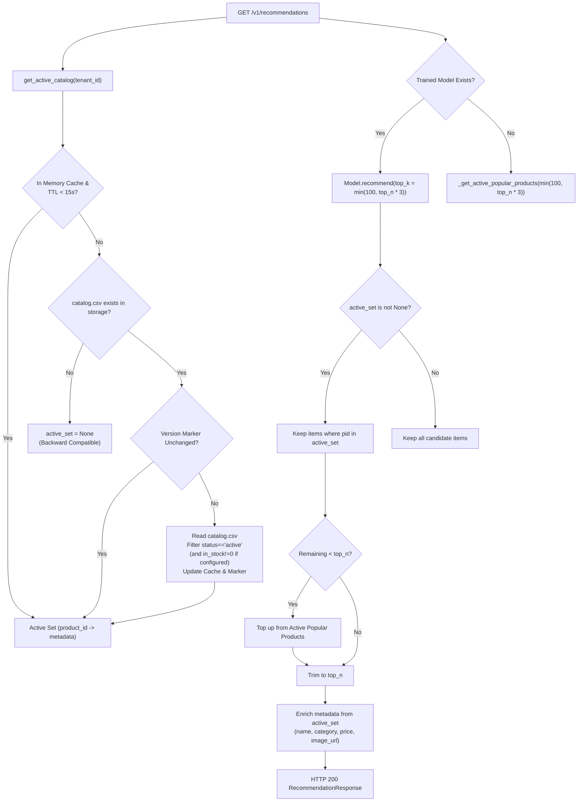

# Step C2: Recommendation Engine & Pipeline Catalogue Integration

**Implementation Status:** Completed & Verified  
**Date:** 2026-11-20  
**Branch:** `catalogue_&_similar_products`  
**Test Suite:** 400 passed, 0 failed, 0 skipped, 0 errors (full regression)  
**Live Check:** Verified on running backend (`http://127.0.0.1:8000`) with throwaway tenant `e2e_test_c2_57444882`

---

## 1. Overview & Objectives

In Step C1, the sovereign tenant product catalogue (`data/catalog/{tenant_id}/catalog.csv`) was established as the primary source of truth through the storage backend, with optimistic concurrency, full CRUD, multipart preview/commit, and snapshot undo.

In Step C2, the recommendation serving layer and the automated machine learning training pipeline were upgraded to strictly obey the tenant-managed catalogue:
1. **Active Set Cache:** In-memory, multi-worker cache with 15-second version marker re-checking. Backward compatible for tenants without a catalogue (no auto-seeding on recommendation hot path).
2. **Instant Catalogue Reflection in Recommendations:** Over-fetching candidates (`min(100, top_n * 3)`), filtering against the active set, topping up from active popularity, and enriching metadata (`product_name`, `category`, `price`, `image_url`) directly from the catalogue so edits appear without retraining.
3. **Pipeline Sovereignty:** The pipeline treats `catalog.csv` as authoritative: candidates/negatives are strictly active catalogue products, interaction products missing from catalogue are safely added with optimistic concurrency, catalogue files are never overwritten, and `data/processed/{tenant}/products.csv` is built directly from active catalogue rows. Training fails cleanly if fewer than 2 active products exist.
4. **Training Markers & Operational Metrics:** Training persists `trained_product_ids_count` and `trained_at` to `status/{tenant}.json`, and writes `models/{tenant}/trained_products.json`. Operational counts in `GET /v1/catalog/summary` accurately track `products_added_since_last_training`, `products_changed_since_last_training`, and `never_trained`.
5. **Dashboard & Telemetry:** Product names are enriched from the active catalogue, and archived products are excluded from `top_products`. Events referencing archived or unknown products log without error.

---

## 2. Files Created & Modified

| File | Status | Description |
|---|---|---|
| `src/catalog/active_set.py` | **Created** | In-memory cached active product set with 15-second version-marker check, `catalog.hide_out_of_stock` config support, and cache invalidation. |
| `src/catalog/__init__.py` | **Modified** | Exported `get_active_catalog` and `clear_active_catalog_cache`. |
| `src/api/recommendations.py` | **Modified** | Over-fetching candidate items, active set filtering, active popularity top-up, and catalogue metadata enrichment across all 5 recommendation paths. |
| `src/pipeline/run.py` | **Modified** | Managed catalogue compliance: interaction sync, `< 2` active products failure guard, active `products.csv` generation, and training markers persistence. |
| `src/catalog/service.py` | **Modified** | `get_catalog_summary` metrics computation (`products_added_since_last_training`, `products_changed_since_last_training`, `never_trained`), and cache invalidation in `save_catalog`. |
| `src/telemetry/reader.py` | **Modified** | Product names enriched from active catalogue, and archived products excluded from `top_products`. |
| `src/api/schemas.py` | **Modified** | Added `price` and `image_url` to `RecommendationItem`; added `products_changed_since_last_training` and `never_trained` to `CatalogSummaryResponse`. |
| `tests/test_catalog_engine.py` | **Created** | Comprehensive unit & integration tests covering caching, TTL, rename/price reflection, out-of-stock, <2 products failure, interaction sync, multi-worker cache sync, 5k item timing test, summary metrics, and S3 moto lifecycle. |
| `scripts/live_check_c2.py` | **Created** | Automated end-to-end live check script with throwaway tenant verification against running uvicorn server. |
| `docs/changes/07_catalog.md` | **Modified** | Updated Known Limitations section to cross-reference C2 completion. |
| `docs/changes/08_catalog_engine.md` | **Created** | This engineering design, test, and verification document. |

---

## 3. Architecture & Resolution Flows

### 3.1 Recommendation Resolution Flow



### 3.2 Pipeline Rules & Training Markers

When `data/catalog/{tenant_id}/catalog.csv` exists in storage:
1. **Interaction Product Sync:** Interactions referencing product IDs not currently in `catalog.csv` are safely appended to `catalog.csv` as `status="active"`, `in_stock=1`, `category="General"` with optimistic concurrency (retrying once on 409). The count is tracked and recorded as `products_added_from_interactions`.
2. **Archived Interactions Preserved:** Interactions referencing archived products remain permanently in raw data and `data/processed/{tenant}/interactions.csv`. Historical behavioral records are never erased.
3. **Active Set Threshold Guard:** If `len(active_products) < 2`, pipeline immediately aborts with `ValueError("Catalogue for tenant '{tenant_id}' has fewer than 2 active products (...)")`, updates status in `status/{tenant_id}.json` to `status="failed"`, and halts before model training.
4. **Active Candidate & Negative Universe:** `data/processed/{tenant}/products.csv` and the `products` DataFrame passed to models contain strictly active catalogue rows. All candidate selections and negative sampling in models (Content-Based, Collaborative Filtering, Hybrid, XGBoost) operate exclusively over active catalogue items.
5. **No Catalogue Overwrites:** The pipeline never modifies or deletes existing catalogue rows or files.
6. **Training Markers:** At the conclusion of a successful training run:
   - `trained_product_ids_count` and `trained_at` are persisted into `status/{tenant_id}.json`.
   - `models/{tenant_id}/trained_products.json` is written to storage containing the sorted list of trained product IDs.
   - In-memory model and active catalogue caches are cleared.

### 3.3 Summary Metrics Definitions (`GET /v1/catalog/summary`)

- `active`: Count of products where `status == "active"`.
- `archived`: Count of products where `status == "archived"`.
- `out_of_stock`: Count of active products where `in_stock == 0`.
- `by_category`: Dictionary of counts per category for active products.
- `products_added_since_last_training`: Count of active catalogue products whose `product_id` is NOT present in `models/{tenant_id}/trained_products.json`. If tenant has never completed training, returns `0`.
- `products_changed_since_last_training`: Count of active catalogue products where `updated_at > trained_at`. If never trained, returns `0`.
- `never_trained`: Boolean flag indicating whether the tenant has never completed a model training run.

---

## 4. Test Suite Execution & Verification

### A. Catalogue Engine Test Suite (`tests/test_catalog_engine.py`)

12 comprehensive tests verifying all C2 requirements:

```
tests/test_catalog_engine.py::test_archiving_and_restoring_recommendations PASSED [  8%]
tests/test_catalog_engine.py::test_product_rename_and_price_reflection_without_retrain PASSED [ 16%]
tests/test_catalog_engine.py::test_hide_out_of_stock_configuration PASSED [ 25%]
tests/test_catalog_engine.py::test_tenant_without_catalog_backward_compatible PASSED [ 33%]
tests/test_catalog_engine.py::test_pipeline_run_obeys_managed_catalog PASSED [ 41%]
tests/test_catalog_engine.py::test_simulated_workers_cache_coherency PASSED [ 50%]
tests/test_catalog_engine.py::test_pipeline_fails_when_fewer_than_two_active_products PASSED [ 58%]
tests/test_catalog_engine.py::test_catalog_engine_tenant_isolation PASSED [ 66%]
tests/test_catalog_engine.py::test_timing_benchmark_5000_product_catalog PASSED [ 75%]
tests/test_catalog_engine.py::test_catalog_summary_metrics PASSED        [ 83%]
tests/test_catalog_engine.py::test_s3_storage_catalog_engine_lifecycle PASSED [ 91%]
tests/test_catalog_engine.py::test_dashboard_analytics_excludes_archived_products PASSED [100%]

============================= 12 passed in 21.18s =============================
```

### B. All Catalogue Subsystem Tests

Combined run of all catalogue test modules:
```
pytest tests/test_catalog.py tests/test_catalog_feed_sync.py tests/test_catalog_engine.py -q
...................................                                      [100%]
35 passed in 51.41s
```

### C. Full Project Regression (`pytest tests/ -q`)

Executed across the entire codebase:
```
400 passed in 1393.87s (0:23:13)
Passed: 400 | Failed: 0 | Skipped: 0 | Errors: 0
```
Zero regressions across all existing authentication, multi-tenancy, onboarding, telemetry, dashboard, Shopify, and model training subsystems.

---

## 5. Live Verification Log (`scripts/live_check_c2.py`)

Executed against live `uvicorn` instance (`http://127.0.0.1:8000`) with throwaway tenant `e2e_test_c2_57444882`:

```
======================================================================
STARTING C2 LIVE VERIFICATION: RECOMMENDATIONS & PIPELINE CATALOGUE
======================================================================

[1] Starting backend uvicorn server on port 8000...
Backend server is UP and responding at http://127.0.0.1:8000

[2] Registering account: 'E2E Test C2 57444882' (e2e_c2_57444882@example.com)...
POST /v1/accounts/signup -> HTTP 201
Created Tenant ID: e2e_test_c2_57444882, Account ID: acc_76tdmd

[3] Reading verification code via /v1/accounts/dev/last-verification...
Verification code: 163868

[4] Verifying email...
Email successfully verified.

[5] Logging in for JWT session token...
Session token obtained.

[6] Generating & uploading dataset (300 customers, 40 products, 3,000 interactions)...
Uploaded: 3000 rows, 6 columns.

[7] Profiling & confirming tenant configuration...
Tenant configuration confirmed and persisted to config.yaml.

[8] Triggering training via POST /v1/onboard/train...
Training initiated. Polling /v1/onboard/status...
   Status: queued (Stage: None) - Training job for tenant 'e2e_test_c2_57444882' has been queued.
   Status: completed (Stage: completed) - Model tournament successfully completed. Winner: Dynamic Hybrid.
Training completed successfully! Winning model: Dynamic Hybrid

[9] Initializing catalogue via GET /v1/catalog/summary...
Catalogue Summary: active=40, archived=0, added_since_train=0

[10] Requesting recommendations for customer 'CUST_0001'...
Received 5 recommendations:
   - PROD_012: 'Product Item 012' (Category: General)
   - PROD_010: 'Product Item 010' (Category: General)
   - PROD_011: 'Product Item 011' (Category: General)
   - PROD_015: 'Product Item 015' (Category: General)
   - PROD_020: 'Product Item 020' (Category: General)

[11] Archiving products 'PROD_012' and 'PROD_010'...
Both products archived.

[12] Verifying archived products are excluded from recommendations...
New recommendations: ['PROD_011', 'PROD_015', 'PROD_020', 'PROD_024', 'PROD_026']
Archived products successfully excluded and replaced by active products.

[13] Restoring product 'PROD_012'...
Product 'PROD_012' restored to active status.

[14] Adding new product 'PROD_NEW_999' to catalogue...
Summary after add: products_added_since_last_training=1

[15] Retraining tenant via POST /v1/onboard/train...
Retraining completed: Model tournament successfully completed. Winner: Dynamic Hybrid.
Summary after retrain: products_added_since_last_training=0

======================================================================
ALL C2 LIVE VERIFICATION CHECKS PASSED SUCCESSFULLY!
Throwaway Tenant ID: e2e_test_c2_57444882
======================================================================

Shutting down backend uvicorn server...
Server stopped cleanly.
```

