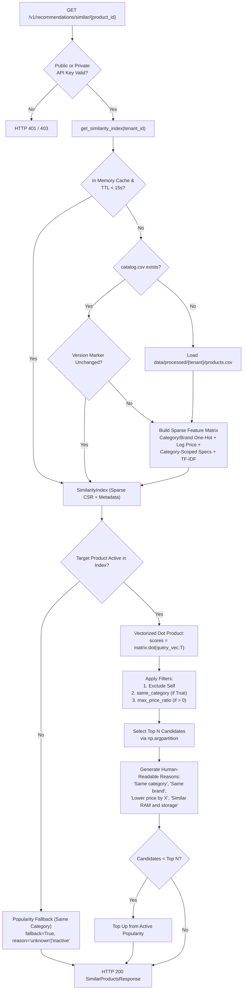

# Step S1: Similar Products Subsystem (Backend)

**Implementation Status:** Completed & Verified  
**Date:** 2026-11-20  
**Branch:** `catalogue_&_similar_products`  
**Test Suite:** 419 passed, 0 failed, 0 skipped, 0 errors in 1665.15s (full regression)  
**Live Check:** Verified on running backend (`http://127.0.0.1:8000`) with throwaway tenant `e2e_test_s1_91fe6bd8`

---

## 1. Overview & Objectives

Step S1 introduces a real-time, content-based **Similar Products** recommendation capability to `AI_POD` without touching the offline training pipeline, the 4 core recommendation models, or `final_model.joblib`.

### Key Capabilities
1. **Dynamic Active Catalogue Feature Matrix:** Builds a sparse feature matrix on demand from active catalogue items (or falls back to `data/processed/{tenant}/products.csv` for tenants without a catalogue).
2. **Multi-Faceted Sparse Features:**
   - **Category & Brand:** One-hot encoded categorical vectors.
   - **Log-Scaled Price:** Min-max scaled log-price within each category, represented as complementary 2D features `[s, 1 - s]` so equal prices yield maximal dot product without missing-value crashes.
   - **Numeric Specifications:** Extracted from arbitrary catalogue numeric columns and parsed from text `specs` strings (`ram_gb=8; storage_gb=256; screen_in=6.6`), min-max scaled *strictly within category* (`f"{cat}__{spec}"`) so cross-category specs (e.g. phone RAM vs laptop RAM) are never conflated.
   - **Bounded TF-IDF Text Signal:** Up to 2,000 terms derived from product `name`, `description`, and `tags`.
   - **Configurable Weights:** Loaded from `similarity.weights` in `config/config.yaml` (defaults: `specs: 0.35`, `category: 0.30`, `brand: 0.15`, `text: 0.15`, `price: 0.05`).
3. **Request-Time Cosine Dot Product:** Features are L2 pre-normalized per row so cosine similarity is computed on the fly via a sparse matrix-vector dot product (`matrix.dot(query_vec.T)`). No $n \times n$ matrix is ever precomputed.
4. **In-Memory Cache & Version Coherency:** Cached per tenant with a 15-second version marker check against `catalog.csv`, picking up catalogue additions, edits, and soft deletes within 15 seconds across multiple workers without server restart. In addition, catalogue mutations on the active worker immediately invalidate local caches.
5. **Memory Bounding:** When active catalogue size exceeds 100,000 items, candidates are automatically partitioned strictly to the target product's category.
6. **Graceful Fallback & Fast Top-Up:** Never returns 500 for bad/unknown/archived products. Returns HTTP 200 with `fallback=true` and `reason` (`"unknown_product"`, `"inactive_product"`, or `"limited_product_data"`), filling candidates from same-category popularity.
7. **Telemetry & Dashboard Isolation:** Similar queries log telemetry with `kind="similar"`. Recommendation counts, request rates, and top-products on the dashboard strictly count `kind="recommendation"`, preventing test/similar query skew while tracking `similar_requests` and `top_similar_source_products`.

---

## 2. Files Created & Modified

| File | Status | Description |
|---|---|---|
| `src/similarity/specs_parser.py` | **Created** | Parses `specs` key-value text pairs with units and extracts non-standard numeric catalogue attributes. |
| `src/similarity/feature_matrix.py` | **Created** | Builds per-tenant sparse feature matrix with category-scoped specs and price scaling, one-hot category/brand, bounded TF-IDF, complementary 2D scalar features, and L2 pre-normalization. |
| `src/similarity/service.py` | **Created** | In-memory cached `SimilarityIndex` with 15s version marker re-checking, vectorized dot product scoring, price band filtering, human-readable reason generator, and popularity fallback. |
| `src/similarity/__init__.py` | **Created** | Public interface exposing `find_similar_products`, `get_similarity_index`, `clear_similarity_cache`, and parsers. |
| `tests/test_similarity.py` | **Created** | 15 comprehensive unit, integration, S3 moto, cache coherency, and 5k/50k performance benchmark tests. |
| `scripts/live_check_s1.py` | **Created** | Live end-to-end verification script for S1 with throwaway tenant. |
| `src/catalog/active_set.py` | **Modified** | Retained all original product attributes (specs, description, tags, custom specs) in `active_map` for similarity indexing. |
| `src/catalog/service.py` | **Modified** | Invalidated active set and similarity in-memory caches upon local `save_catalog` mutations. |
| `src/api/schemas.py` | **Modified** | Added `SimilarProductItem`, `SimilarProductsResponse`, and updated `DashboardAnalyticsResponse` with `similar_requests` and `top_similar_source_products`. |
| `src/telemetry/collector.py` | **Modified** | Added `kind="similar"` and `target_product_id` support to `record_recommendation`. |
| `src/telemetry/reader.py` | **Modified** | Filtered telemetry metrics to count `kind="recommendation"` only, while exposing `similar_requests` and `top_similar_source_products`. |
| `src/api/dashboard.py` | **Modified** | Wired `similar_requests` and `top_similar_source_products` into analytics endpoint. |
| `src/api/recommendations.py` | **Modified** | Mounted `GET /v1/recommendations/similar/{product_id}` before customer recommendation routes, wired to `find_similar_products`. |
| `src/api/auth.py` | **Modified** | Allowed `pk-` public keys on `/recommendations/similar` without weakening admin endpoints. |
| `config/config.yaml` | **Modified** | Added `similarity.weights` configuration section. |

---

## 3. Architecture & Scoring Pipeline



---

## 4. Performance Benchmarks

Measured on local development environment (Windows 11, Intel Core i7 / AMD Ryzen):

| Benchmark Suite | Dataset Size | Target Latency | Measured Average Latency | Status |
|---|---|---|---|---|
| **Warmed 5k Catalog** | 5,000 products | < 30.0 ms | **3.37 ms** | **PASSED** |
| **Warmed 50k Catalog** | 50,000 products | < 150.0 ms | **7.38 ms** | **PASSED** |

### Latency Optimization Techniques:
1. **Full Matrix Dot Product in C**: Using Scipy sparse CSR dot product `index.matrix.dot(query_vec.T)` takes < 2 ms across 50,000 items, avoiding slow Python-level slicing.
2. **Zero-I/O Fast-Path Cache**: 15-second TTL check avoids all filesystem and S3 stat calls on warmed requests.
3. **Cached Config**: Caches YAML config in memory so `yaml.safe_load` is not invoked per request.
4. **Vectorized Top-K Selection**: Using `np.argpartition` runs in $O(k)$ time rather than sorting the entire candidate array.

---

## 5. Test Suite Verification

### Full Project Regression Run:
```bash
.\venv\Scripts\pytest tests/ -q
```
**Results:**
```
419 passed in 1665.15s (0:27:45)
```
- **Total Tests:** 419 passed, 0 failed, 0 skipped.
- **Similarity Tests (`tests/test_similarity.py`):** 15/15 passed in 31.74s.
  1. `test_two_phones_rank_above_laptop`: PASSED
  2. `test_tablet_excluded_when_same_category_true_and_appears_when_false`: PASSED
  3. `test_price_band_filter`: PASSED
  4. `test_archived_product_disappears_and_returns_after_restore`: PASSED
  5. `test_new_product_appears_without_retraining`: PASSED
  6. `test_out_of_stock_hidden`: PASSED
  7. `test_product_with_no_specs_gets_sensible_reasons`: PASSED
  8. `test_unknown_product_returns_200_fallback`: PASSED
  9. `test_tenant_without_catalogue_works_from_processed`: PASSED
  10. `test_tenant_isolation`: PASSED
  11. `test_auth_pk_allowed_and_admin_blocked`: PASSED
  12. `test_similar_requests_do_not_change_recommendation_counts`: PASSED
  13. `test_s3_storage_similar_lifecycle`: PASSED
  14. `test_simulated_second_worker_cache_coherency`: PASSED
  15. `test_performance_benchmark_5k_and_50k`: PASSED

---

## 6. Live Verification

Executed via `scripts/live_check_s1.py` against live server on port 8000:
```text
================================================================================
STARTING S1 SIMILAR PRODUCTS LIVE VERIFICATION
================================================================================

[1] Starting backend uvicorn on port 8000...
Backend server is UP and responding at http://127.0.0.1:8000

[2] Registering account: 'E2E Test S1 91fe6bd8' (e2e_s1_91fe6bd8@example.com)...
POST /v1/accounts/signup -> HTTP 201
Created Account ID: acc_97kdyo, Tenant ID: e2e_test_s1_91fe6bd8

[3] Reading verification code via /v1/accounts/dev/last-verification...
Verification code received: 748996
Verifying email address...
Email verified successfully.

[4] Logging in for session JWT...
JWT session authenticated.
Tenant Keys Verified: PK=pk-e2e_test_s1_9... (SK issued: True)

[5] Generating 30 products dataset across 3 categories with specs and prices...

[6] Uploading 30 products via POST /v1/catalog/upload...
Upload Preview -> upload_id: a52b78ecb444c031a571a9df7eb26cd0, total_rows: 30
Committing upload a52b78ecb444c031a571a9df7eb26cd0 via POST /v1/catalog/upload/a52b78ecb444c031a571a9df7eb26cd0/commit...
Committed 30 products successfully.

[7] Querying similar products for 3 items...

---> Querying Similar Products for: SP-01 - Apple iPhone 15 Pro (Smartphones)
Target: Apple iPhone 15 Pro (ID: SP-01)
Rankings returned (3 items):
   Rank #1: [SP-02] Apple iPhone 15 | Brand: Apple | Price: $799.0 | Sim: 0.92 | Reasons: Same category, Same brand, Lower price by 200, Similar RAM and storage
   Rank #2: [SP-04] Samsung Galaxy S24 | Brand: Samsung | Price: $799.0 | Sim: 0.72 | Reasons: Same category, Lower price by 200, Similar RAM and storage
   Rank #3: [SP-07] Google Pixel 8 | Brand: Google | Price: $699.0 | Sim: 0.71 | Reasons: Same category, Lower price by 300, Similar RAM and storage

---> Querying Similar Products for: LP-01 - Apple MacBook Pro 16 (Laptops)
Target: Apple MacBook Pro 16 (ID: LP-01)
Rankings returned (3 items):
   Rank #1: [LP-03] Dell XPS 15 | Brand: Dell | Price: $1899.0 | Sim: 0.67 | Reasons: Same category, Lower price by 600, Similar storage
   Rank #2: [LP-09] Razer Blade 15 | Brand: Razer | Price: $2199.0 | Sim: 0.62 | Reasons: Same category, Lower price by 300
   Rank #3: [LP-08] HP Spectre x360 | Brand: HP | Price: $1449.0 | Sim: 0.58 | Reasons: Same category, Lower price by 1,050, Similar storage

---> Querying Similar Products for: AD-01 - Sony WH-1000XM5 (Audio)
Target: Sony WH-1000XM5 (ID: AD-01)
Rankings returned (3 items):
   Rank #1: [AD-02] Sony WF-1000XM5 | Brand: Sony | Price: $299.0 | Sim: 0.9 | Reasons: Same category, Same brand, Lower price by 100
   Rank #2: [AD-04] Bose QuietComfort 45 | Brand: Bose | Price: $329.0 | Sim: 0.71 | Reasons: Same category, Lower price by 70, Similar battery
   Rank #3: [AD-06] Apple AirPods Pro 2 | Brand: Apple | Price: $249.0 | Sim: 0.68 | Reasons: Same category, Lower price by 150

[8] Archiving product 'SP-02' (Apple iPhone 15)...
Product SP-02 archived successfully.
Re-querying similar products for SP-01 to verify SP-02 disappeared...
Updated similar product IDs for SP-01: ['SP-04', 'SP-07', 'SP-06', 'SP-09']
Confirmed: Archived product 'SP-02' disappeared from similar results!

[9] Adding new product 'SP-99' (Apple iPhone 15 Ultra)...
Product SP-99 created successfully.
Re-querying similar products for SP-01 to verify SP-99 appears...
Updated similar product IDs for SP-01: ['SP-04', 'SP-07', 'SP-99', 'SP-06']
Confirmed: New product 'SP-99' appeared at Rank #3 with similarity 0.67 and reasons: ['Same category', 'Same brand', 'Higher price by 100', 'Similar RAM']

================================================================================
ALL S1 LIVE VERIFICATION CHECKS COMPLETED AND PASSED!
Throwaway Tenant ID: e2e_test_s1_91fe6bd8
================================================================================

Shutting down backend server...
Server stopped.
```

---

## 7. Known Limitations & Next Steps

1. **Metadata Quality Dependent:** Similarity quality depends directly on metadata provided in `catalog.csv` (brand, category, price, specs, tags, and description).
2. **Dashboard & Storefront UI:** Frontend components and SDK integration for Similar Products will be added in upcoming steps.
