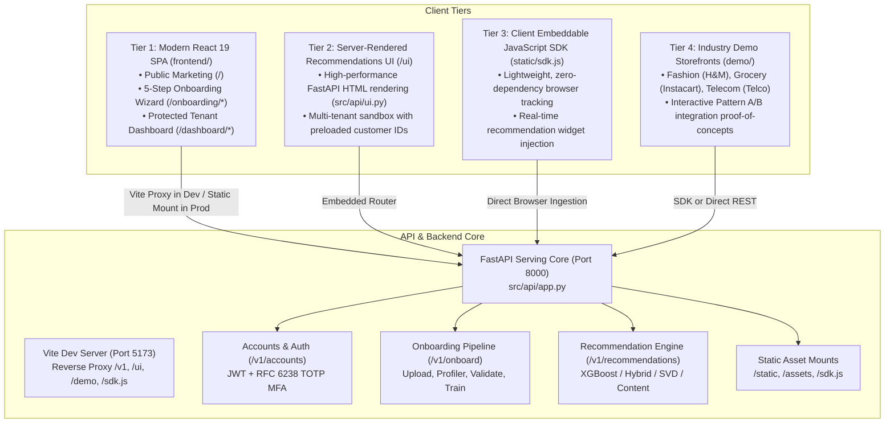
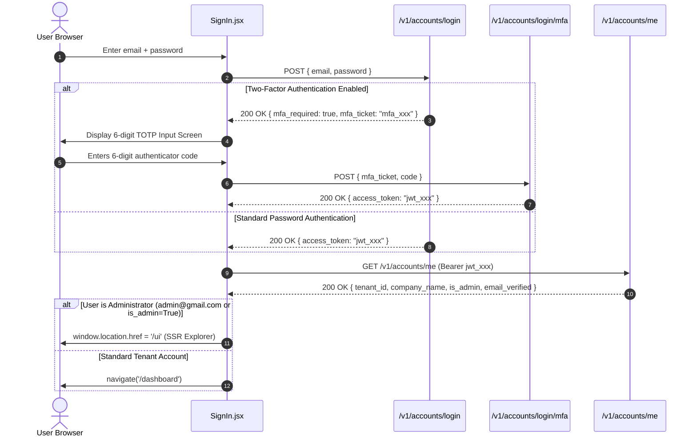
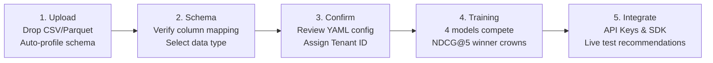
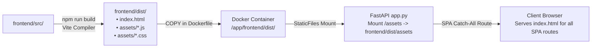

# AI_POD Frontend Architecture & Development Guide

**Authoritative Technical Reference for UI Applications, Client SDKs, and Storefront Integrations**  
*Project Repository: AI_POD (Domain-Agnostic Multi-Tenant Recommendation Engine)*  
*Document Version: 2.0 | Last Updated: November 2026*

---

## Table of Contents

1. [Executive Summary & Frontend Topology](#1-executive-summary--frontend-topology)
2. [Technology Stack & System Requirements](#2-technology-stack--system-requirements)
3. [Repository Directory & Asset Manifest](#3-repository-directory--asset-manifest)
4. [Routing Architecture & Navigation Flows](#4-routing-architecture--navigation-flows)
5. [Authentication, MFA & Security Model](#5-authentication-mfa--security-model)
6. [State Management & React Contexts](#6-state-management--react-contexts)
7. [API Client & Network Integration Layer](#7-api-client--network-integration-layer)
8. [Automated 5-Step Onboarding Wizard](#8-automated-5-step-onboarding-wizard)
9. [Tenant Administration Dashboard](#9-tenant-administration-dashboard)
10. [Public Marketing Pages](#10-public-marketing-pages)
11. [Design System, Styling & CSS Architecture](#11-design-system-styling--css-architecture)
12. [Server-Rendered Recommendations Explorer (`/ui`)](#12-server-rendered-recommendations-explorer-ui)
13. [Client-Side Embeddable JavaScript SDK (`static/sdk.js`)](#13-client-side-embeddable-javascript-sdk-staticsdkjs)
14. [Interactive Industry Demo Storefronts (`demo/`)](#14-interactive-industry-demo-storefronts-demo)
15. [Build, Containerization & Serving Strategy](#15-build-containerization--serving-strategy)
16. [Developer Quickstart & Operational Commands](#16-developer-quickstart--operational-commands)
17. [Troubleshooting & Frequently Asked Questions](#17-troubleshooting--frequently-asked-questions)

---

## 1. Executive Summary & Frontend Topology

The **AI_POD** frontend ecosystem delivers a unified, zero-code experience for multi-tenant recommendation onboarding, real-time telemetry, model tournament evaluation, and cross-platform embedding. Rather than maintaining disparate ad-hoc user interfaces, AI_POD employs a cohesive four-tier frontend topology:



### Key Capabilities

1. **Zero-Code Dataset Ingestion**: Drop raw CSV, Parquet, or JSON files into the browser. The automated profiler identifies schema dimensions, candidate identifiers, and interaction types in seconds.
2. **Competitive Model Tournament Arena**: Visualizes 4 disparate algorithms (Content-Based Cosine, Collaborative Filtering SVD, Dynamic Hybrid Rank Blend, and Supervised XGBoost) battling live on client data, crowning the NDCG@5 winner.
3. **Enterprise Security & Key Isolation**: Full separation between client-safe Public Keys (`pk-...`) and backend-only Private Keys (`sk-...`), supported by RFC 6238 TOTP Two-Factor Authentication (MFA) and account-level brute-force lockout.
4. **Interactive Dashboard & Telemetry**: Powered by [Recharts](https://recharts.org/), providing real-time visibility into weekly event volume, top recommended catalog products, click-through rates (CTR), and model fallback frequencies.
5. **Universal Drop-In Integration**: Instantly generates production-ready embed snippets for plain HTML (`<script>` tag), npm packages, and raw cURL requests.

---

## 2. Technology Stack & System Requirements

### Frontend Dependencies ([`package.json`](file:///d:/Projects/AI_POD/frontend/package.json))

| Layer | Technology | Version | Purpose |
| :--- | :--- | :--- | :--- |
| **Runtime Core** | [React](file:///d:/Projects/AI_POD/frontend/package.json#L14) | `^19.3.1` | Concurrent rendering, component state, modern hooks |
| **DOM Renderer** | [React DOM](file:///d:/Projects/AI_POD/frontend/package.json#L15) | `^19.3.1` | Browser document mounting and portal management |
| **Routing** | [React Router](file:///d:/Projects/AI_POD/frontend/package.json#L16) | `^7.18.5` | Declarative client-side routing, nested layouts, route guards |
| **Data Visualization** | [Recharts](file:///d:/Projects/AI_POD/frontend/package.json#L17) | `^3.10.1` | Responsive SVG charts (Line charts, vertical bar charts) |
| **Iconography** | [Lucide React](file:///d:/Projects/AI_POD/frontend/package.json#L13) | `^1.64.0` | Comprehensive lightweight SVG icons |
| **Bundler / Tooling** | [Vite](file:///d:/Projects/AI_POD/frontend/package.json#L24) | `^8.3.5` | Lightning-fast ESM dev server, HMR, and Rollup production bundling |
| **Babel/React Plugin**| `@vitejs/plugin-react` | `^6.1.2` | Fast JSX transformations |
| **Linter** | [Oxlint](file:///d:/Projects/AI_POD/frontend/package.json#L23) | `^1.89.0` | High-performance Rust-based linter |

### Environment Requirements

- **Node.js**: `v20.x` or `v22.x` LTS recommended.
- **Package Manager**: `npm` (v10+), `pnpm` (v9+), or `yarn` (v1.22+).
- **Backend Service**: AI_POD FastAPI backend running on `http://localhost:8000`.

---

## 3. Repository Directory & Asset Manifest

```
frontend/
├── .env                     # Local environment overrides (VITE_API_URL)
├── .gitignore               # Git ignore rules for node_modules, dist, .env
├── .oxlintrc.json           # Oxlint static analysis rules
├── index.html               # Main HTML entrypoint with metadata and root mount
├── package.json             # NPM package manifest & dependency declarations
├── package-lock.json        # Deterministic lockfile
├── README.md                # Template documentation
├── vite.config.js           # Vite configuration with reverse proxy definitions
├── public/
│   ├── vite.svg             # Vite brand icon
│   └── favicon.ico          # Application favicon
└── src/
    ├── main.jsx             # React DOM root initialization with StrictMode
    ├── App.jsx              # Central router, auth provider & route declarations
    ├── index.css            # Global CSS design tokens, animations & utility classes
    ├── api/
    │   └── client.js        # Centralized HTTP request client & API methods
    ├── assets/
    │   ├── hero.png         # Marketing hero graphic
    │   └── react.svg        # React logo
    ├── components/
    │   ├── CodeBlock.jsx    # Syntax container with one-click clipboard copy
    │   ├── KeyDisplay.jsx   # Secret masking/unmasking & API key viewer
    │   └── Navbar.jsx       # Floating sticky header with responsive mobile drawer
    ├── context/
    │   ├── AuthContext.jsx       # Authentication state, JWT tokens & user profiles
    │   └── OnboardingContext.jsx # 5-step wizard session state & dataset metadata
    └── pages/
        ├── Landing.jsx           # Public homepage with animated counters & hero
        ├── Features.jsx          # Categorized system capabilities breakdown
        ├── HowItWorks.jsx        # 3-step interactive operational explanation
        ├── SignIn.jsx            # Sign-in portal with RFC 6238 TOTP 2FA handling
        ├── SignUp.jsx            # Account registration & tenant ID generation
        ├── dashboard/
        │   ├── DashboardLayout.jsx # Collapsible sidebar layout & account badge
        │   ├── Overview.jsx        # KPI stat cards, model health & live event feed
        │   ├── ApiKeys.jsx         # Key management, rotation modal & permissions
        │   ├── ModelStatus.jsx     # Tournament leaderboard & retrain orchestrator
        │   ├── Analytics.jsx       # Recharts telemetry graphs & weekly metrics
        │   └── Settings.jsx        # Profile updating, password change & Danger Zone
        └── onboarding/
            ├── OnboardingLayout.jsx # Wizard progress header & ambient backdrop
            ├── UploadStep.jsx       # Drag & drop upload + auto-profiler results
            ├── SchemaStep.jsx       # AI candidate column mapper & data type selector
            ├── ConfirmStep.jsx      # Tenant customization & live YAML generator
            ├── TrainingStep.jsx     # Competitive 4-model arena & live polling
            └── IntegrateStep.jsx    # Key provisioning, SDK snippets & live rec tester
```

---

## 4. Routing Architecture & Navigation Flows

The client-side routing is powered by `react-router-dom` v7 in [`frontend/src/App.jsx`](file:///d:/Projects/AI_POD/frontend/src/App.jsx#L45-L78).

### Route Table

| Path | Element / Component | Access Level | Description |
| :--- | :--- | :--- | :--- |
| `/` | [`Landing.jsx`](file:///d:/Projects/AI_POD/frontend/src/pages/Landing.jsx) | Public | Brand presentation, value proposition, animated metrics |
| `/features` | [`Features.jsx`](file:///d:/Projects/AI_POD/frontend/src/pages/Features.jsx) | Public | Deep dive into Core AI, Ingestion, API/SDK, and Security |
| `/how-it-works` | [`HowItWorks.jsx`](file:///d:/Projects/AI_POD/frontend/src/pages/HowItWorks.jsx) | Public | 3-step architectural walkthrough with interactive callouts |
| `/signup` | [`SignUp.jsx`](file:///d:/Projects/AI_POD/frontend/src/pages/SignUp.jsx) | Public | Account creation, tenant slugification, key initialization |
| `/signin` | [`SignIn.jsx`](file:///d:/Projects/AI_POD/frontend/src/pages/SignIn.jsx) | Public | Password auth, TOTP 2FA verification, admin routing |
| `/ui` | `UiRedirect` | Public | Browser redirect to FastAPI SSR sandbox (`/ui`) |
| `/demo` | `UiRedirect` | Public | Browser redirect to FastAPI SSR sandbox (`/ui`) |
| `/onboarding` | [`OnboardingLayout.jsx`](file:///d:/Projects/AI_POD/frontend/src/pages/onboarding/OnboardingLayout.jsx) | Semi-Protected | 5-step wizard shell with active progress bar |
| `/onboarding/upload` | [`UploadStep.jsx`](file:///d:/Projects/AI_POD/frontend/src/pages/onboarding/UploadStep.jsx) | Semi-Protected | Step 1: File dropzone and schema auto-profiler |
| `/onboarding/schema` | [`SchemaStep.jsx`](file:///d:/Projects/AI_POD/frontend/src/pages/onboarding/SchemaStep.jsx) | Semi-Protected | Step 2: Customer/Product ID mapping & data type selection |
| `/onboarding/confirm` | [`ConfirmStep.jsx`](file:///d:/Projects/AI_POD/frontend/src/pages/onboarding/ConfirmStep.jsx) | Semi-Protected | Step 3: Tenant ID specification & live YAML preview |
| `/onboarding/training` | [`TrainingStep.jsx`](file:///d:/Projects/AI_POD/frontend/src/pages/onboarding/TrainingStep.jsx) | Semi-Protected | Step 4: Real-time 4-model competitive training arena |
| `/onboarding/integrate`| [`IntegrateStep.jsx`](file:///d:/Projects/AI_POD/frontend/src/pages/onboarding/IntegrateStep.jsx) | Semi-Protected | Step 5: Keys, SDK snippets & live rec sandbox |
| `/dashboard` | [`Overview.jsx`](file:///d:/Projects/AI_POD/frontend/src/pages/dashboard/Overview.jsx) | **Private** | High-level metrics, health status, and live event log |
| `/dashboard/keys` | [`ApiKeys.jsx`](file:///d:/Projects/AI_POD/frontend/src/pages/dashboard/ApiKeys.jsx) | **Private** | Public/Private key secrets, rotation, endpoint matrix |
| `/dashboard/model` | [`ModelStatus.jsx`](file:///d:/Projects/AI_POD/frontend/src/pages/dashboard/ModelStatus.jsx) | **Private** | Tournament performance table, metrics, retraining |
| `/dashboard/analytics`| [`Analytics.jsx`](file:///d:/Projects/AI_POD/frontend/src/pages/dashboard/Analytics.jsx) | **Private** | Recharts event volume and top recommended products |
| `/dashboard/settings` | [`Settings.jsx`](file:///d:/Projects/AI_POD/frontend/src/pages/dashboard/Settings.jsx) | **Private** | Company profile, password updater, danger zone |
| `*` | `<Navigate to="/" replace />` | Public | Automatic catch-all redirect to homepage |

### Private Route Guarding

In [`frontend/src/App.jsx`](file:///d:/Projects/AI_POD/frontend/src/App.jsx#L27-L36), `<PrivateRoute>` inspects the authentication context:
1. While `loading === true` (verifying token validity against `/v1/accounts/me`), an animated CSS spinner is displayed against a full-screen canvas.
2. If `user` is non-null, child routes are rendered.
3. If unauthenticated, the user is redirected via `<Navigate to="/signin" replace />`.

---

## 5. Authentication, MFA & Security Model

The frontend adheres to strict zero-trust standards documented in [auth_hardening_report.md](file:///d:/Projects/AI_POD/docs/auth_hardening_report.md).



### Local Storage Security Matrix

The frontend isolates credentials in `localStorage`:

| Key Name | Content | Scope & Sensitivity |
| :--- | :--- | :--- |
| `aipod_token` | Signed JSON Web Token (JWT) | High sensitivity. Injected into `Authorization: Bearer <token>` for all account & onboarding operations. Removed on logout or 401 response. |
| `aipod_pk` | Tenant Public Key (`pk-live-...`) | Safe for browser exposure. Used in `X-API-Key` headers for client recommendations and SDK initialization. |
| `aipod_sk` | Tenant Private Key (`sk-live-...`) | High sensitivity. Only displayed to user upon signup or explicit key rotation. Never transmitted to third-party endpoints. |

### Role-Based Redirection

In [`SignIn.jsx`](file:///d:/Projects/AI_POD/frontend/src/pages/SignIn.jsx#L38-L43), after successful token issuance:
```javascript
const isAdmin = form.email.trim().toLowerCase() === 'admin@gmail.com' || me?.is_admin || me?.role === 'admin';
if (isAdmin) {
  window.location.href = '/ui'; // Direct access to cross-tenant testing suite
} else {
  navigate('/dashboard');       // Tenant management console
}
```

---

## 6. State Management & React Contexts

AI_POD avoids bulky third-party state managers by utilizing clean, domain-separated React Context providers.

### 1. `AuthContext` ([`frontend/src/context/AuthContext.jsx`](file:///d:/Projects/AI_POD/frontend/src/context/AuthContext.jsx))

Manages user identity and persistence across page reloads:
- **`user`**: User object containing `company_name`, `email`, `tenant_id`, `email_verified`, `public_key`.
- **`loading`**: Boolean indicating initial token validation.
- **`login(token, userData)`**: Writes `aipod_token` and `aipod_pk` to `localStorage` and updates reactive state.
- **`logout()`**: Purges `aipod_token`, `aipod_pk`, and resets user state to `null`.
- **Automatic Hydration**: On mount, if `aipod_token` exists, calls [`getMe()`](file:///d:/Projects/AI_POD/frontend/src/api/client.js#L26-L29). If the token is revoked or expired, the session is cleared automatically.

### 2. `OnboardingContext` ([`frontend/src/context/OnboardingContext.jsx`](file:///d:/Projects/AI_POD/frontend/src/context/OnboardingContext.jsx))

Retains transient state during the 5-step dataset onboarding wizard:
- **`profile`**: Output from `/v1/onboard/upload` containing row count, column count, inferred column types, and candidate IDs.
- **`mapping`**: Column bindings (`customer_id_column`, `product_id_column`, `interaction_type`).
- **`config`**: Verified YAML configuration object payload.
- **`tenantId`**: Active workspace identifier selected or generated by the user.
- **`keys`**: Pair of newly minted API credentials (`{ pk, sk }`).
- **`reset()`**: Flushes wizard state for a fresh onboarding cycle.

---

## 7. API Client & Network Integration Layer

All backend network operations flow through [`frontend/src/api/client.js`](file:///d:/Projects/AI_POD/frontend/src/api/client.js).

### Architecture of `request()`

```javascript
const BASE_URL = import.meta.env.VITE_API_URL || '/v1';

async function request(path, options = {}) {
  const token = localStorage.getItem('aipod_token');
  const headers = {
    'Content-Type': 'application/json',
    ...(token ? { Authorization: `Bearer ${token}` } : {}),
    ...options.headers,
  };
  const res = await fetch(`${BASE_URL}${path}`, { ...options, headers });
  const data = await res.json().catch(() => ({}));
  if (!res.ok) throw { status: res.status, message: data.detail || 'Request failed' };
  return data;
}
```

### Full Endpoint Method Reference

| Exported Function | HTTP Method | Target Endpoint | Description |
| :--- | :--- | :--- | :--- |
| [`signup(body)`](file:///d:/Projects/AI_POD/frontend/src/api/client.js#L21) | `POST` | `/accounts/signup` | Registers new company account & provisions keys |
| [`login(body)`](file:///d:/Projects/AI_POD/frontend/src/api/client.js#L22) | `POST` | `/accounts/login` | Validates credentials; returns token or MFA ticket |
| [`loginMfa(body)`](file:///d:/Projects/AI_POD/frontend/src/api/client.js#L23) | `POST` | `/accounts/login/mfa` | Validates 6-digit TOTP code against MFA ticket |
| [`verifyEmail(body)`](file:///d:/Projects/AI_POD/frontend/src/api/client.js#L24) | `POST` | `/accounts/verify-email` | Confirms account ownership using 6-digit code |
| [`resendVerification()`](file:///d:/Projects/AI_POD/frontend/src/api/client.js#L25) | `POST` | `/accounts/resend-verification` | Dispatches new email verification code |
| [`getMe(explicitToken)`](file:///d:/Projects/AI_POD/frontend/src/api/client.js#L26-L29) | `GET` | `/accounts/me` | Fetches active authenticated user profile |
| [`regenerateKeys()`](file:///d:/Projects/AI_POD/frontend/src/api/client.js#L30) | `POST` | `/accounts/keys/regenerate` | Rotates public and private API keys |
| [`mfaSetup()`](file:///d:/Projects/AI_POD/frontend/src/api/client.js#L33) | `POST` | `/accounts/mfa/setup` | Generates TOTP secret, QR code URI & backup codes |
| [`mfaEnable(body)`](file:///d:/Projects/AI_POD/frontend/src/api/client.js#L34) | `POST` | `/accounts/mfa/enable` | Activates TOTP enforcement after code verification |
| [`mfaDisable(body)`](file:///d:/Projects/AI_POD/frontend/src/api/client.js#L35) | `POST` | `/accounts/mfa/disable` | Deactivates MFA protection |
| [`onboardUpload(formData)`](file:///d:/Projects/AI_POD/frontend/src/api/client.js#L38-L43) | `POST` | `/onboard/upload` | Uploads multipart file and profiles dataset |
| [`onboardValidate(body)`](file:///d:/Projects/AI_POD/frontend/src/api/client.js#L45) | `POST` | `/onboard/validate` | Validates selected column mappings against data |
| [`onboardConfirm(body)`](file:///d:/Projects/AI_POD/frontend/src/api/client.js#L46) | `POST` | `/onboard/confirm` | Persists confirmed schema and tenant configuration |
| [`onboardTrain()`](file:///d:/Projects/AI_POD/frontend/src/api/client.js#L47) | `POST` | `/onboard/train` | Triggers 4-model competitive training run |
| [`onboardStatus()`](file:///d:/Projects/AI_POD/frontend/src/api/client.js#L48) | `GET` | `/onboard/status` | Polls training status, winner model, and metrics |
| [`getRecommendations()`](file:///d:/Projects/AI_POD/frontend/src/api/client.js#L51-L54) | `GET` | `/recommendations/{id}?top_n={n}` | Queries live recommendations with `X-API-Key` |

### Vite Reverse Proxy ([`vite.config.js`](file:///d:/Projects/AI_POD/frontend/vite.config.js))

To prevent Cross-Origin Resource Sharing (CORS) complications during local development, Vite proxies API requests to the backend server:

```javascript
export default defineConfig({
  plugins: [react()],
  server: {
    port: 5173,
    proxy: {
      '/v1':     { target: 'http://localhost:8000', changeOrigin: true },
      '/ui':     { target: 'http://localhost:8000', changeOrigin: true },
      '/demo':   { target: 'http://localhost:8000', changeOrigin: true },
      '/sdk.js': { target: 'http://localhost:8000', changeOrigin: true },
    }
  }
})
```

---

## 8. Automated 5-Step Onboarding Wizard

The onboarding wizard guides non-technical operators through dataset ingestion, AI schema inference, configuration confirmation, competitive model training, and integration.



### Step 1: Upload ([`UploadStep.jsx`](file:///d:/Projects/AI_POD/frontend/src/pages/onboarding/UploadStep.jsx))
- **Interactive Drag-and-Drop Dropzone**: Supports `.csv`, `.parquet`, and `.json` datasets up to 100 MB.
- **Auto-Profiler Telemetry Card**: Upon upload to `/v1/onboard/upload`, immediately presents the inferred row count, column count, and detected interaction format.

### Step 2: Schema Mapping ([`SchemaStep.jsx`](file:///d:/Projects/AI_POD/frontend/src/pages/onboarding/SchemaStep.jsx))
- **Intelligent Column Dropdowns**: Pre-populates customer and product identifier selects with AI candidate columns.
- **Interaction Type Selector**:
  - `Transactional`: Standard event log where each row represents a discrete interaction.
  - `Service Matrix`: Wide-format data where each row is a customer and columns indicate subscribed services.

### Step 3: Confirm Configuration ([`ConfirmStep.jsx`](file:///d:/Projects/AI_POD/frontend/src/pages/onboarding/ConfirmStep.jsx))
- **Tenant ID Customization**: Sanitizes input string to lowercase alphanumeric slugs (`[a-z0-9_]`).
- **Live YAML Syntax Generation**: Dynamically formats tenant configuration into production-grade YAML:
  ```yaml
  tenants:
    acme_retail:
      customers:
        id_column: customer_id
      products:
        derived_from: transactional
        id_column: product_id
      interactions:
        source: transactional
  ```

### Step 4: Model Training Arena ([`TrainingStep.jsx`](file:///d:/Projects/AI_POD/frontend/src/pages/onboarding/TrainingStep.jsx))
- **Live Algorithm Tournament**: Displays visual progress cards for the 4 competing models:
  1. **Content-Based**: Profile Cosine Similarity (`#3b82f6`)
  2. **Collaborative Filtering**: TruncatedSVD Latent Space (`#818cf8`)
  3. **Dynamic Hybrid**: Rank Blend Ensemble (`#06b6d4`)
  4. **Learned Ranking**: Supervised XGBoost Classifier (`#10b981`)
- **Status Polling Loop**: Repeatedly queries `/v1/onboard/status` every 3 seconds to update model states (`queued` -> `training` -> `evaluating` -> `done`).
- **Trophy Banner**: Highlights the crowned winning algorithm alongside its validation metrics: **NDCG@5**, **Precision@5**, and **Recall@5**.

### Step 5: Integration & Verification ([`IntegrateStep.jsx`](file:///d:/Projects/AI_POD/frontend/src/pages/onboarding/IntegrateStep.jsx))
- **Key Security Display**: Outputs Public Key (`pk-live-...`) for browser embedding and Private Key (`sk-live-...`) with a one-time save warning.
- **Multi-Tab Code Snippets**: Provides copy-ready code blocks for HTML Script embedding, NPM `@aipod/sdk`, and cURL REST calls.
- **Live Recommendation Sandbox**: Form field allowing the operator to input any customer identifier from their dataset to preview live ranked recommendations directly in the browser.

---

## 9. Tenant Administration Dashboard

The protected dashboard provides operational management and analytics for active tenants.

### Dashboard Layout ([`DashboardLayout.jsx`](file:///d:/Projects/AI_POD/frontend/src/pages/dashboard/DashboardLayout.jsx))
- Fixed left sidebar navigation on desktop with collapsible drawer on mobile.
- Displays the active company name and tenant ID badge.
- Navigation links:
  - **Overview**: System health and stats.
  - **Recommendations**: Direct link to the `/ui` SSR sandbox.
  - **API Keys**: Key viewer, rotation, and endpoint permissions.
  - **Model Status**: Tournament breakdown and retraining trigger.
  - **Analytics**: Recharts telemetry.
  - **Settings**: Company info, password updater, and tenant deletion.

### Overview Page ([`Overview.jsx`](file:///d:/Projects/AI_POD/frontend/src/pages/dashboard/Overview.jsx))
- **Stat Cards**: Model Status, Tenant ID, Daily Request Count, Active Key Count.
- **Model Health Card**: Displays deployed winner model and validation NDCG@5 score.
- **Quick Action Grid**: One-click shortcuts to dataset upload, keys, retraining, and analytics.
- **Live Event Stream Feed**: Simulated real-time interaction log showing incoming customer events (`view`, `click`, `add_to_cart`, `purchase`).

### API Key Management ([`ApiKeys.jsx`](file:///d:/Projects/AI_POD/frontend/src/pages/dashboard/ApiKeys.jsx))
- **Public vs. Private Key Viewers**: Features one-click clipboard copy and password-style reveal toggles (`Eye` / `EyeOff`) via [`KeyDisplay.jsx`](file:///d:/Projects/AI_POD/frontend/src/components/KeyDisplay.jsx).
- **Cryptographic Key Rotation**: Modal confirmation invoking `/v1/accounts/keys/regenerate`.
- **Key Permission Matrix**: Clear visual table outlining client vs. server endpoint access:
  ```
  Endpoint                    Public Key    Private Key
  GET  /v1/recommendations        ✅            ✅
  POST /v1/track                  ✅            ✅
  POST /v1/onboard/*              ❌            ✅
  GET  /v1/onboard/status          ❌            ✅
  POST /v1/retrain/*              ❌            ✅
  GET  /v1/accounts/me            ❌            ✅
  ```

### Model Status & Leaderboard ([`ModelStatus.jsx`](file:///d:/Projects/AI_POD/frontend/src/pages/dashboard/ModelStatus.jsx))
- **Leaderboard Table**: Compares all 4 trained models sorted by NDCG@5 with Precision@5, Recall@5, and deployment status badges.
- **Dataset Statistics**: Customer, Product, and Interaction counts with visual progress limits.
- **Retrain Trigger**: One-click action invoking `/v1/onboard/train` and seamlessly navigating the operator back to the training arena.

### Analytics Telemetry ([`Analytics.jsx`](file:///d:/Projects/AI_POD/frontend/src/pages/dashboard/Analytics.jsx))
- **Recharts Event Volume Line Chart**: 7-day multi-line chart tracking `views`, `clicks`, `cart_adds`, and `purchases`.
- **Top Products Horizontal Bar Chart**: Ranked horizontal bars displaying the most frequently recommended catalog items with custom gradient fills.
- **KPI Summary Pills**: Total Events (`+18%`), Total Recommendations (`+24%`), CTR (`14.2%`), and Fallback Rate (`3.1%`).

### Settings & Danger Zone ([`Settings.jsx`](file:///d:/Projects/AI_POD/frontend/src/pages/dashboard/Settings.jsx))
- **Company Profile**: Update company name and contact email.
- **Immutable Tenant ID**: Explains that the tenant slug cannot be altered post-provisioning.
- **Password Modification**: Secure password update form with client-side length validation.
- **Danger Zone**: Explicit account deletion safety gate requiring the user to type `DELETE`.

---

## 10. Public Marketing Pages

### Landing Page ([`Landing.jsx`](file:///d:/Projects/AI_POD/frontend/src/pages/Landing.jsx))
- **Hero Section**: High-impact headline, subheadings, and primary call-to-action buttons.
- **Animated Counter Components**: Uses `IntersectionObserver` to count smoothly from 0 to target metrics (e.g., 99.4% accuracy, 10-minute setup, 4 models).
- **Industry Cards**: Clickable showcase cards for E-Commerce, Grocery Delivery, Fashion Apparel, and Telecom.

### Features Page ([`Features.jsx`](file:///d:/Projects/AI_POD/frontend/src/pages/Features.jsx))
- Organized into 4 tabbed categories with animated intersection reveals:
  1. **Core AI**: Domain-agnostic intelligence, autonomous model selection, one-click retraining.
  2. **Data Handling**: Universal ingestion (CSV, Parquet, JSON), transactional & service matrix, S3 & Shopify native connectors.
  3. **API & SDK**: Sub-50ms REST API, embeddable JavaScript SDK, webhooks & event streams.
  4. **Enterprise Security**: Multi-tenant isolation, public/private key split, RFC 6238 TOTP MFA, SOC2-ready architecture.

### How It Works ([`HowItWorks.jsx`](file:///d:/Projects/AI_POD/frontend/src/pages/HowItWorks.jsx))
- Visual step-by-step breakdown:
  - **Step 1: Upload & Auto-Profile** (Schema inference and data cleaning).
  - **Step 2: 4-Model Tournament** (Parallel training and NDCG@5 competition).
  - **Step 3: Embed & Track** (SDK script tags, event tracking, and identity merging).

---

## 11. Design System, Styling & CSS Architecture

The application design is defined in [`frontend/src/index.css`](file:///d:/Projects/AI_POD/frontend/src/index.css). It uses standard CSS custom properties (design tokens) without heavy utility frameworks.

### Design Tokens (`:root`)

```css
:root {
  /* Surfaces */
  --bg-base:          #080c14;
  --bg-surface:       #0e1420;
  --bg-card:          #111827;
  --bg-card-hover:    #161e2e;
  --bg-input:         #0d1525;

  /* Borders & Glows */
  --border:           rgba(99, 179, 237, 0.12);
  --border-glow:      rgba(99, 179, 237, 0.35);

  /* Accents & Brand Gradients */
  --accent-1:         #3b82f6; /* Electric Blue */
  --accent-2:         #818cf8; /* Soft Indigo */
  --accent-3:         #06b6d4; /* Vivid Cyan */
  --accent-grad:      linear-gradient(135deg, #3b82f6 0%, #818cf8 50%, #06b6d4 100%);
  --accent-grad-soft: linear-gradient(135deg, rgba(59,130,246,.18) 0%, rgba(129,140,248,.18) 100%);

  /* Typography */
  --text-primary:     #f0f4ff;
  --text-secondary:   #94a3b8;
  --text-muted:       #4b5563;

  /* Feedback Colors */
  --success:          #10b981;
  --warning:          #f59e0b;
  --danger:           #ef4444;
  --info:             #06b6d4;

  /* Border Radii */
  --radius-sm:        6px;
  --radius:           12px;
  --radius-lg:        20px;
  --radius-xl:        28px;
}
```

### Visual Effects & Layout Classes

- **Ambient Background Orbs**: Blurred, floating ambient color shapes (`.orb`, `.orb-blue`, `.orb-purple`, `.orb-cyan`) positioned absolute behind content layers.
- **Glassmorphism**: `.card-glass` incorporates semi-transparent dark backgrounds with `backdrop-filter: blur(20px)` and subtle glowing borders.
- **Typography Scale**: Headers utilize Google Font `Outfit`, while body copy runs on `Inter`.
- **Responsive Layout Grids**: `.grid-2`, `.grid-3`, `.grid-4` adjust automatically using CSS grid and media queries at `1024px`, `768px`, and `640px`.

---

## 12. Server-Rendered Recommendations Explorer (`/ui`)

Defined in [`src/api/ui.py`](file:///d:/Projects/AI_POD/src/api/ui.py), the `/ui` route is an ultra-fast, server-side rendered FastAPI HTML application designed for immediate algorithm testing and client demonstrations.

```
       FastAPI Backend (/ui)
                 │
                 ▼
 ┌───────────────────────────────┐
 │ Dynamic Tenant Switcher       │ ◄── Loads available tenants from config & auth records
 ├───────────────────────────────┤
 │ Sample Customer ID Picker     │ ◄── Discovers known customer IDs per tenant
 ├───────────────────────────────┤
 │ Live Recommendation Engine    │ ◄── Calls get_model_for_tenant() directly
 ├───────────────────────────────┤
 │ Scoring & Fallback Inspector  │ ◄── Visualizes rank, score, confidence & fallback flag
 └───────────────────────────────┘
```

### Key Features
1. **Multi-Tenant Switcher**: Dynamically inspects [`config/config.yaml`](file:///d:/Projects/AI_POD/config/config.yaml) and registered accounts to provide a dropdown of all live tenants (`telco_default`, `fresh_cart_co`, `thread_co`, `online_retail`, `movielens_demo`, etc.).
2. **Pre-Loaded Customer IDs**: Automatically extracts real customer IDs from processed data files to allow one-click testing without guessing valid IDs.
3. **Debug Telemetry**: Exposes model latency, active algorithm type, customer feature vector values, and whether the engine served personalization or fallback popularity rankings.

---

## 13. Client-Side Embeddable JavaScript SDK (`static/sdk.js`)

[`static/sdk.js`](file:///d:/Projects/AI_POD/static/sdk.js) is a self-contained, zero-dependency tracking and recommendation injection library (<25 KB).

### Integration Pattern

```html
<!-- Drop into the <head> or <body> of any website -->
<script
  src="https://api.aipod.io/sdk.js"
  data-tenant-key="pk-live-xxxxxxxxxxxxxxxxxxxxxxxxxxxxxxxx">
</script>

<script>
  // 1. Resolve customer identity on login
  aipod.identify('cust_98231');

  // 2. Track real-time visitor behaviors
  aipod.track('view', { product_id: 'SKU-001' });
  aipod.track('add_to_cart', { product_id: 'SKU-001' });
  aipod.track('purchase', { product_id: 'SKU-001', amount: 49.99 });

  // 3. Render automated recommendation carousel
  aipod.getRecommendations({
    top_n: 4,
    containerId: 'recommended-products-container',
    template: function(item) {
      return '<div class="product-card">' +
               '' +
               '<h4>' + item.product_name + '</h4>' +
               '<p>' + item.price + '</p>' +
             '</div>';
    }
  });
</script>
```

### Architectural Highlights

- **Hybrid Session Persistence**: Uses `localStorage` as primary session storage (avoiding HTTP cookie overhead on static assets), automatically falling back to first-party cookies (`SameSite=Lax`) in restricted browsing environments, and finally an in-memory buffer.
- **Identity Merging**: Seamlessly maps anonymous browsing sessions (`session_id`) to authenticated customer accounts (`customer_id`) via `/v1/track`.
- **Zero Host Crash Guarantee**: Every API invocation, DOM insertion, and network call is wrapped in defensive try/catch blocks to ensure that host website execution is never disrupted.

---

## 14. Interactive Industry Demo Storefronts (`demo/`)

The repository includes pre-built storefront mockups located in [`demo/`](file:///d:/Projects/AI_POD/demo/) demonstrating diverse industry applications:

1. **Fashion Apparel ([`demo/hm_fashion.html`](file:///d:/Projects/AI_POD/demo/hm_fashion.html))**: E-commerce catalog simulating size, color, and apparel category recommendations based on real transaction patterns.
2. **Grocery Delivery ([`demo/instacart_grocery.html`](file:///d:/Projects/AI_POD/demo/instacart_grocery.html))**: Fast-moving consumer goods storefront featuring frequent basket add-ons and department-level suggestions.
3. **Telecom Portal ([`demo/telco_portal.html`](file:///d:/Projects/AI_POD/demo/telco_portal.html))**: Subscription portal showing plan add-on recommendations (Tech Support, Streaming TV, Online Security) to reduce subscriber churn.
4. **General Storefront ([`demo/storefront.html`](file:///d:/Projects/AI_POD/demo/storefront.html))**: Multi-category e-commerce storefront with live SDK integration.
5. **Standalone Onboarding Studio ([`demo/onboarding.html`](file:///d:/Projects/AI_POD/demo/onboarding.html))**: Single-file HTML demonstration of the onboarding experience.
6. **SDK Test Harness ([`demo/test_sdk.html`](file:///d:/Projects/AI_POD/demo/test_sdk.html))**: Automated diagnostic page for validating tracking events and recommendation rendering.

---

## 15. Build, Containerization & Serving Strategy

In production, the React SPA is compiled into static assets and served directly through the FastAPI application server, eliminating the need for a separate Node.js server.



### FastAPI SPA Catch-All Configuration ([`src/api/app.py`](file:///d:/Projects/AI_POD/src/api/app.py#L117-L120), [`L295-L306`](file:///d:/Projects/AI_POD/src/api/app.py#L295-L306))

```python
# Mount compiled frontend assets
frontend_dist_assets = PROJECT_ROOT / "frontend" / "dist" / "assets"
if frontend_dist_assets.exists():
    app.mount("/assets", StaticFiles(directory=str(frontend_dist_assets)), name="frontend-assets")

# SPA Root & HTML Fallbacks
@app.get("/", response_class=HTMLResponse)
@app.get("/features", response_class=HTMLResponse)
@app.get("/how-it-works", response_class=HTMLResponse)
@app.get("/signup", response_class=HTMLResponse)
@app.get("/signin", response_class=HTMLResponse)
@app.get("/dashboard", response_class=HTMLResponse)
@app.get("/dashboard/{full_path:path}", response_class=HTMLResponse)
def ui_root():
    frontend_dist_index = PROJECT_ROOT / "frontend" / "dist" / "index.html"
    if frontend_dist_index.exists():
        return FileResponse(frontend_dist_index)
    return HTMLResponse(build_home_page())
```

---

## 16. Developer Quickstart & Operational Commands

### 1. Local Development (Vite + FastAPI)

Open two terminal sessions:

#### Terminal 1: Start FastAPI Backend
```bash
# From repository root
python -m uvicorn src.api.app:app --host 0.0.0.0 --port 8000 --reload
```

#### Terminal 2: Start Vite Dev Server
```bash
# Navigate to frontend workspace
cd frontend

# Install dependencies
npm install

# Start development server
npm run dev
```
Navigate your browser to `http://localhost:5173`. Vite will proxy API calls directly to port 8000.

### 2. Compiling Production Bundle
```bash
cd frontend
npm run build
```
This produces optimized production bundles in `frontend/dist/`. Once compiled, running FastAPI on port 8000 will serve the React application directly at `http://localhost:8000/`.

### 3. Code Quality & Linting
```bash
cd frontend
npm run lint
```
Executes `oxlint` for rapid static analysis and code verification.

---

## 17. Troubleshooting & Frequently Asked Questions

### Q1: API calls return `401 Unauthorized` in the dashboard
- **Cause**: The stored JWT token (`aipod_token`) has expired or the server was restarted with a new JWT signing secret.
- **Remedy**: Click "Sign Out" in the sidebar and log in again, or execute `localStorage.clear()` in the browser developer console.

### Q2: Onboarding file upload fails with network error
- **Cause**: The FastAPI backend is not running or the reverse proxy port in `vite.config.js` is pointing to an incorrect host.
- **Remedy**: Ensure `http://localhost:8000/health` returns `{"status":"ok"}`. If running in a container, verify the port mapping `-p 8000:8000`.

### Q3: Direct navigation to `/dashboard/keys` produces a 404 in production
- **Cause**: The production web server is not configured for HTML5 History API fallback.
- **Remedy**: Verify that [`src/api/app.py`](file:///d:/Projects/AI_POD/src/api/app.py#L300-L306) has the catch-all route `@app.get("/dashboard/{full_path:path}")` returning `frontend/dist/index.html`.

### Q4: Charts fail to render on the Analytics tab
- **Cause**: Recharts container rendered with zero dimensions prior to flexbox calculation.
- **Remedy**: Ensure parent containers have explicit height declarations or use `<ResponsiveContainer width="100%" height={260}>`.

---

*End of Frontend Architecture & Development Guide.*

