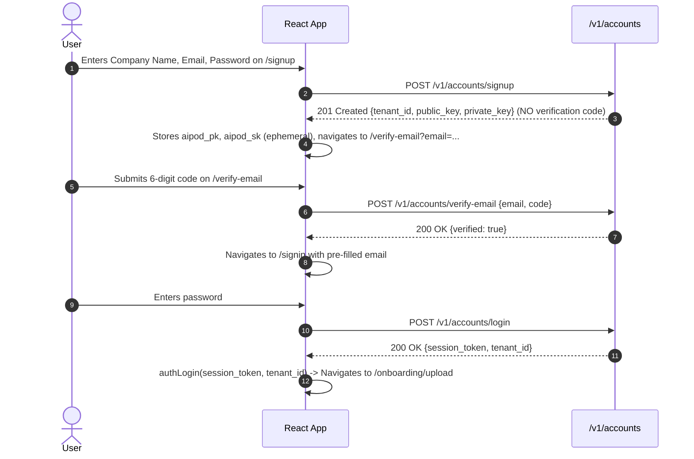

# AI_POD Frontend Architecture & Operations Guide

**Comprehensive Technical Guide for AI_POD React Frontend**  
*Stack: React 19, Vite, React Router 7, Tailwind CSS, Heroicons*  
*Document Version: 3.0 (Production Verified) | Date: November 2026*

---

## 1. Frontend Architecture & Routing Overview

The AI_POD frontend is a client-side Single Page Application (SPA) located in `frontend/`. It communicates with the FastAPI backend over REST APIs.

### 1.1 Route Map (`frontend/src/App.jsx`)

| Route | Component | Access Control | Purpose |
| :--- | :--- | :--- | :--- |
| `/` | `Landing.jsx` | Public | Marketing landing page with hero, features, and pricing |
| `/signin` | `SignIn.jsx` | Public | Email/password login with lockout handling & TOTP MFA challenge |
| `/signup` | `SignUp.jsx` | Public | Company registration; receives public & secret keys |
| `/verify-email` | `VerifyEmail.jsx` | Public | 6-digit confirmation code input with 60s resend cooldown |
| `/onboarding/upload` | `UploadStep.jsx` | Authenticated | Step 1: Upload dataset CSV |
| `/onboarding/validate` | `ValidateStep.jsx` | Authenticated | Step 2: Inferred schema mapping and validation report |
| `/onboarding/confirm` | `ConfirmStep.jsx` | Authenticated | Step 3: Candidate config confirmation |
| `/onboarding/train` | `TrainingStep.jsx` | Authenticated | Step 4: Real tournament training status polling |
| `/onboarding/integrate` | `IntegrateStep.jsx` | Authenticated | Step 5: Public API key display, code snippets & SDK |
| `/dashboard` | `Overview.jsx` | Authenticated | High-level metrics, active model status, request count |
| `/dashboard/analytics` | `Analytics.jsx` | Authenticated | 7-day traffic telemetry charts & event distributions |
| `/dashboard/events` | `Events.jsx` | Authenticated | Live stream of raw tracking events (views, carts, purchases) |
| `/dashboard/models` | `Models.jsx` | Authenticated | Model tournament leaderboard (NDCG@5, Precision, Recall) |
| `/dashboard/keys` | `ApiKeys.jsx` | Authenticated | Public key display, secret key rotation & one-time reveal |

---

## 2. Authentication & Credential Management

### 2.1 Dual Key & Session Model
- **Public Key (`aipod_pk`)**: Persisted in `localStorage`. Safe for client-side embedding, storefront tracking widgets, and recommendation queries.
- **Private Key (`aipod_sk`)**: Treated with strict ephemeral handling.
  - When issued at signup or rotated in `ApiKeys.jsx`, it is temporarily held in memory or displayed once with a clear notice:
    > ⚠️ Copy this secret key now. After you leave this page it cannot be shown again.
  - Acknowledging the prompt or navigating away removes `aipod_sk` from `localStorage` immediately.
  - All admin requests (wizard steps, dashboard stats) authenticate using the **Bearer Session JWT** stored in `session_token`, never the secret key.
- **Session JWT (`session_token`)**: Managed by `src/context/AuthContext.jsx`. Injected into `Authorization: Bearer <token>` headers for all `/v1/onboard/*`, `/v1/dashboard/*`, and `/v1/accounts/*` requests.

### 2.2 Email Verification Journey


### 2.3 Unverified Login Handling
If a user attempts to log in to `/signin` before verifying their email:
1. Backend responds with **HTTP 403 Forbidden** (`"Email address has not been verified"`).
2. `SignIn.jsx` intercepts the 403, triggers a resend automatically via `resendVerification({ email })`, and redirects to `/verify-email?email=...`.

---

## 3. Real Onboarding Wizard (No Mock Simulations)

In earlier versions, the onboarding progress UI used local `setTimeout` loops and simulated random percentages. In the current production release:

1. **Zero Mock Code**: All artificial timeouts, randomized metric generators, and mock states have been completely eliminated.
2. **Real Polling Loop**: In `TrainingStep.jsx`, the component initiates real polling upon mount:
   ```javascript
   useEffect(() => {
     fetchStatus();
     const interval = setInterval(fetchStatus, 3000);
     return () => clearInterval(interval);
   }, []);
   ```
3. **Live Server Status**: Calls `GET /v1/onboard/status` with `Authorization: Bearer <session_token>`.
4. **Reactive UI**: Displays server-calculated progress (0-100%), per-model training cards (Content-Based, Collaborative Filtering, Dynamic Hybrid, Learned Ranking XGBoost), holdout NDCG@5 scores, and the winning model designation.
5. **Auto-Advance**: When `status.status === "completed"`, polling terminates and the user advances to `IntegrateStep.jsx`.

---

## 4. Real Dashboard Pages

The dashboard tabs consume real backend data from `/v1/dashboard/*`:

1. **Overview (`Overview.jsx`)**:
   - Queries `GET /v1/dashboard/overview`.
   - Displays tenant name, model status badge, winning model, holdout NDCG@5, requests today, and dataset statistics (number of customers, products, and interactions).
2. **Analytics (`Analytics.jsx`)**:
   - Queries `GET /v1/dashboard/analytics?days=7`.
   - Displays daily recommendation volume and event distribution (views, add-to-carts, purchases). Test traffic (`X-AIPOD-Source: wizard-test`) is automatically excluded.
3. **Events (`Events.jsx`)**:
   - Queries `GET /v1/dashboard/events?limit=20`.
   - Renders a live feed table of telemetry events received from client storefronts.
4. **Models (`Models.jsx`)**:
   - Queries `GET /v1/dashboard/models`.
   - Displays candidate model status, NDCG@5, Precision@5, and Recall@5 metrics directly from tournament evaluation.
5. **API Keys (`ApiKeys.jsx`)**:
   - Shows active public key.
   - Provides a "Regenerate Keys" button hitting `POST /v1/accounts/keys/regenerate`.
   - Displays newly issued secret key with a one-time copy modal that purges `aipod_sk` from browser storage upon dismissal.

---

## 5. Development & Production Commands

### Running Locally with Backend
```bash
# Terminal 1: Backend API (port 8000)
python -m uvicorn src.api.app:app --host 127.0.0.1 --port 8000

# Terminal 2: Frontend Vite Dev Server (port 5173)
cd frontend
npm run dev
```

### Linting & Production Build
```bash
cd frontend
npm run lint    # Executes oxlint / eslint (0 errors)
npm run build   # Executes vite build -> dist/
```

