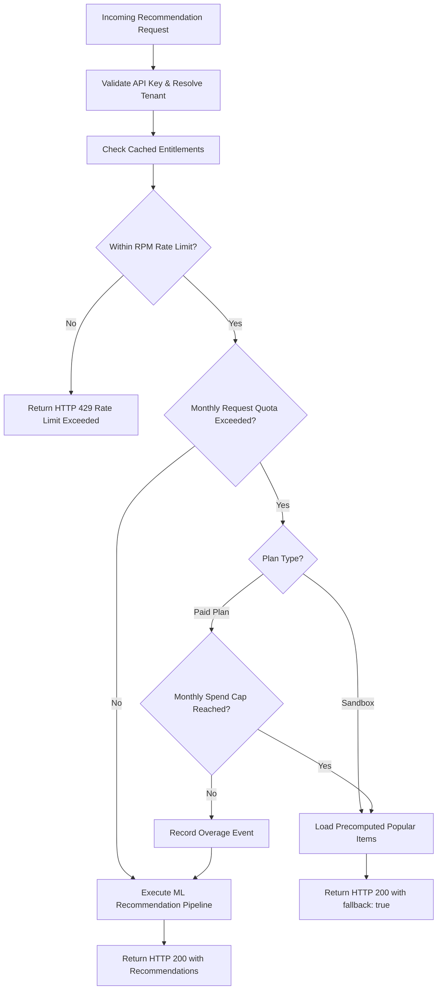
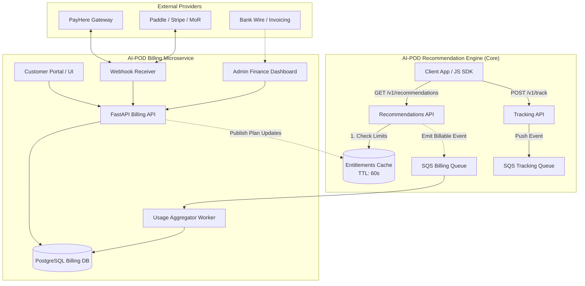
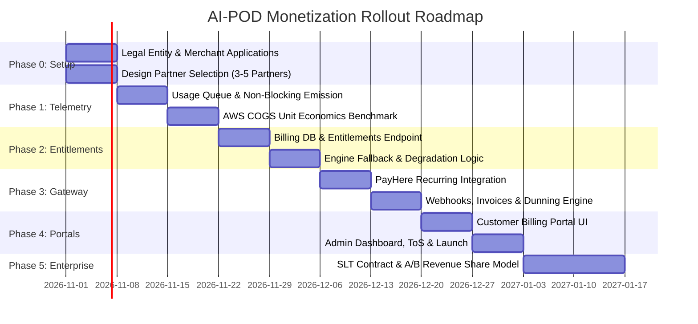

# AI-POD Monetization & Billing System: Comprehensive Execution Plan

**Document Version:** 1.0.0  
**Effective Date:** October 2026  
**Status:** Strategic Architecture & Execution Blueprint (Pre-Implementation)  
**Target System:** AI-POD Multi-Tenant Recommendation Engine & AI-POD Billing Service  

---

## Executive Summary

This document outlines the end-to-end execution plan for monetizing **AI-POD**, an automated, multi-tenant recommendation and hyper-personalization engine. 

The monetization strategy adopts a **usage-metered B2B SaaS model** with self-serve tiers, paired with an **enterprise high-touch contract model** for anchor clients such as Sri Lanka Telecom (SLT). The architecture strictly decouples the billing domain from the core machine learning inference engine:
1. **AI-POD Core Engine** remains focused entirely on low-latency inference, real-time event ingestion, and model training.
2. **AI-POD Billing Service** runs as an independent microservice managing subscriptions, quotas, payment gateways, invoicing, and usage aggregation.
3. Communication between the two systems is constrained to **two minimal, resilient touchpoints**: asynchronous usage event telemetry out, and cached entitlement/quota policies in.

### Strategic Positioning vs. Competitors (Recombee)

Recombee benchmarks at approximately **$99/month for 100k requests** (20k users, 20k items) and scales to **~$899/month for 2M requests** and **$1,500+ for enterprise tiers**. As a market challenger establishing trust, AI-POD's baseline strategy is:
* **~50% price undercut on standard list price** ($49/month for 100k requests; $249/month for 1M requests; $799/month for 5M requests).
* **Generous Event Ingestion Limits** (10:1 event-to-request ratio included across all plans).
* **Graceful Degradation Guarantee**: Free/Sandbox plan quota exhaustion serves popularity fallbacks (`fallback: true`) rather than breaking front-end user experiences with HTTP 429/500 errors.
* **Dual Currency Strategy**: Domestic Sri Lankan clients are quoted in LKR via PayHere or direct bank transfer at purchasing-power-parity (PPP) rates, while global clients are served in USD via a Merchant of Record (Paddle / Lemon Squeezy / Dodo Payments) or Stripe.

---

## 1. What to Charge For: Billable Dimensions & Metering

Costs in AI-POD stem from four computational drivers: CPU/GPU inference load, storage and ingestion throughput, memory/index residency, and batch retraining compute. To align customer value with underlying COGS (Cost of Goods Sold), billing meters four distinct vectors:

| Meter Dimension | Technical Source in AI-POD | Primary COGS Driver | Customer Value Perception |
| :--- | :--- | :--- | :--- |
| **1. Recommendation Requests** | `GET /v1/recommendations`, `GET /v1/recommendations/{customer_id}` | ECS / Fargate container compute, network egress, CPU cache pressure. | Core value: Direct personalized impressions delivered to end consumers. |
| **2. Tracked Events** | `POST /v1/track` (interactions, clicks, add-to-carts, purchases) | SQS message throughput, Lambda/Worker ingestion compute, S3 raw event log storage. | Analytics value: Continuous behavioral signal ingestion. |
| **3. Active Customers & Catalog Items** | Distinct entity IDs processed during pipeline runs (`data/processed/{tenant_id}/`) | Memory footprint during training and inference cache, persistent vector/tabular storage. | Scale value: Size of the client’s customer base and inventory. |
| **4. Retraining Frequency** | Automated batch training runs triggered (`src/pipeline/train.py`, `POST /v1/retrain`) | High-memory training instances, EC2/Fargate compute hours, matrix factorization training jobs. | Freshness value: How quickly the model adapts to seasonal/inventory shifts. |

### Technical Metering Constraints & Edge Cases
1. **Deduplication & Idempotency**:
   - Billable actions emitted from the engine include a deterministic unique ID (`event_id` or `uuidv4` request ID).
   - The billing ingestor aggregates daily counters using database `ON CONFLICT (tenant_id, metric_date, metric_name) DO UPDATE` to guarantee network retries never lead to double-counting.
2. **Health Check & Internal Traffic Exemption**:
   - `GET /health`, `GET /docs`, `/openapi.json`, and admin verification calls do not emit billable usage records.
3. **Public vs. Private Key Attributions**:
   - Both public keys (`pk-...` from client browsers) and private keys (`sk-...` from server backends) map to the single owning `tenant_id`. All consumption rolls up under that tenant.

---

## 2. Subscription Plans, Quotas, and Limits Matrix

### Standard Plan Offerings (USD Monthly / Annual Prepay)
*Annual prepayment offers 12 months of service for the price of 10 months (equivalent to 2 months free, or ~16.7% discount).*

| Plan Tier | Price (USD/mo) | Annual Prepay (USD/yr) | Monthly Requests | Monthly Events | Active Customers | Catalog Items | Retraining Cadence | Per-Min Rate Limit | Request Overage (per 1k req) |
| :--- | :--- | :--- | :--- | :--- | :--- | :--- | :--- | :--- | :--- |
| **Sandbox** | **$0** | $0 | 10,000 | 100,000 | 1,000 | 500 | Weekly | 20 RPM | *No overage* (Falls back) |
| **Starter** | **$49** | $490 | 100,000 | 1,000,000 | 10,000 | 10,000 | Daily | 120 RPM | **$0.60** |
| **Growth** | **$249** | $2,490 | 1,000,000 | 10,000,000 | 100,000 | 100,000 | Nightly + On-demand | 600 RPM | **$0.35** |
| **Scale** | **$799** | $7,990 | 5,000,000 | 50,000,000 | 500,000 | 500,000 | Up to 4x daily | 3,000 RPM | **$0.20** |
| **Enterprise** | **Custom** (From ~$1,500) | Invoiced Annual | Custom SLA | Custom | Custom | Custom | Dedicated compute | Custom | Invoiced Band |

### Unit Economics & Overage Logic
* **Blended Base Rates vs. Overage Rates**:
  - *Starter*: Base rate is $0.49 per 1k requests ($49 / 100k). Overage is priced at **$0.60 per 1k requests** (+22% premium).
  - *Growth*: Base rate is $0.249 per 1k requests ($249 / 1M). Overage is priced at **$0.35 per 1k requests** (+40% premium).
  - *Scale*: Base rate is $0.159 per 1k requests ($799 / 5M). Overage is priced at **$0.20 per 1k requests** (+25% premium).
  - *Economic Rationale*: Keeping overage pricing noticeably higher than the next tier's blended rate prevents billing surprises while providing a natural financial incentive for growing customers to upgrade their base plan.

### Rate Limit Mapping to Codebase
AI-POD already implements tenant-level rate limiting in `src/utils/config.py` (`get_tenant_rate_limit`) and `src/api/rate_limiter.py` (`InMemoryRateLimiter`). The per-minute quotas map directly to the engine's tenant config:
* **Sandbox**: 20 requests/minute (prevents single-client spikes from exhausting shared infrastructure).
* **Starter**: 120 requests/minute.
* **Growth**: 600 requests/minute.
* **Scale**: 3,000 requests/minute.

### Trial & Transition Rules
* **30-Day Growth Trial**: New signups automatically receive 30 days of full **Growth plan limits** without entering a credit card.
* **Trial Expiration**: If no paid subscription is activated by Day 30, the tenant automatically steps down to the **Sandbox tier** without data loss or service disruption.

### Domestic & Local Pricing Strategy (Sri Lanka)
* Direct 1:1 USD-to-LKR conversion creates high friction for local startups and small/medium e-commerce stores in Sri Lanka.
* Domestic quotes will be rendered in **LKR** with localized price anchoring (e.g., Starter at ~LKR 9,500 – 12,500/month; Growth at ~LKR 45,000 – 60,000/month), determined through customer development interviews with early design partners.

### Enterprise Path: Sri Lanka Telecom (SLT) & High-Value Clients
* Enterprise contracts do not run on monthly credit card billing.
* **Structure**:
  1. **Paid Pilot (Proof of Value)**: 60-day to 90-day engagement with fixed fee covering setup, data integration, and A/B test infrastructure.
  2. **Annual Base License + Usage Band**: Minimum annual commitment (e.g., $18,000 – $35,000/year) covering high-volume request allowances, dedicated retraining nodes, and custom SLAs (99.9% uptime).
  3. **Performance-Based Upside**: Option to contract a revenue-share model (e.g., 2%–5% of incremental revenue generated by AI-POD recommendations), measured cleanly against an unpersonalized control group in A/B testing.

---

## 3. Quota Boundary Policies & Graceful Degradation Engine

A critical vulnerability of recommendation SaaS products is breaking a client's e-commerce storefront or streaming portal when limits are hit. AI-POD enforces strict degradation policies:



### 1. Sandbox Quota Exhaustion (`fallback: true`)
* When a Sandbox tenant exceeds 10,000 requests in a billing month:
  - **Do NOT return HTTP 429 Too Many Requests or HTTP 500**.
  - Execute `_get_fallback_recommendations(tenant_id)` (already implemented in `src/api/recommendations.py`).
  - Response payload includes:
    ```json
    {
      "customer_id": "cust_123",
      "recommendations": [...],
      "fallback": true,
      "quota_status": "sandbox_limit_reached"
    }
    ```
  - An automated email notification is dispatched to the tenant owner recommending an upgrade to Starter.

### 2. Paid Plan Quotas, Alerts, and Spend Caps
* **Proactive Threshold Alerts**: Dispatched via webhook and email when monthly consumption crosses **80%** and **100%** of plan allocation.
* **Uncapped Overage**: By default, requests beyond plan limits continue executing personalized recommendations and are billed at the per-1k overage rate at the end of the billing cycle.
* **Tenant Spend Cap (`spend_cap_usd`)**: Customers can set a hard ceiling on overage spend (e.g., "Do not exceed $100 in overage"). Once the spend cap is reached, the engine switches to the popular items fallback (`fallback: true`) rather than incurring unapproved charges.

### 3. Event Ingestion Resilience (`POST /v1/track`)
* **Golden Rule**: Never break a customer's real-time checkout, cart addition, or telemetry pipeline.
* `POST /v1/track` **always returns HTTP 202 Accepted** as long as payload syntax and API keys are valid.
* Events are enqueued onto SQS / Redis Stream. If a tenant has exceeded their monthly event quota:
  - If on a paid plan: Events are ingested normally and accounted for under plan overages.
  - If on Sandbox or spend-capped: Events beyond quota may be counted for metrics and dropped from persistent training storage, accompanied by an administrative alert email.

### 4. Dunning & Payment Failure Lifecycle
When an automated recurring payment fails on PayHere or Stripe:
* **Day 0**: Payment fails. Webhook received. System dispatches "Payment Failed – Update Payment Method" notification.
* **Days 1–7 (Grace Period)**:
  - All services and ML recommendations remain fully operational.
  - Gateway automatically executes automated retries (Day 1, Day 3, Day 5, Day 7).
* **Day 8 (Downgrade to Sandbox)**:
  - If payment remains uncollected after 7 days, tenant status changes from `active` to `past_due_downgraded`.
  - Quotas and rate limits immediately clamp to Sandbox levels (10k requests/mo, 20 RPM).
  - Fallback triggers if usage is currently above 10k requests.
* **Day 38 (30-Day Data Retention Window)**:
  - Historical models and processed datasets in S3/Storage are preserved for 30 days following downgrade.
  - If the account remains inactive after 30 days, tenant models are archived to cold storage.

### 5. Subscription Transitions: Upgrades & Downgrades
* **Upgrades**:
  - Take effect **immediately**.
  - New rate limits and monthly quotas apply within 60 seconds (upon cache invalidation).
  - Prorated credit from the remaining days of the previous plan is applied to the first invoice of the new tier.
* **Downgrades**:
  - Take effect **at the end of the current paid billing cycle**.
  - The customer retains access to higher limits until their paid period concludes.

---

## 4. Payment Gateway Integration Architecture

### Domestic Gateway: PayHere (Sri Lanka)
PayHere is the Central Bank of Sri Lanka-approved payment gateway supporting both LKR and USD billing.

```
                    ┌────────────────────────┐
                    │ AI-POD Billing Service │
                    └───────────┬────────────┘
                                │
        1. Initialize Token Request (Customer ID, Plan, LKR/USD)
                                ▼
                    ┌────────────────────────┐
                    │ PayHere Checkout / API │
                    └───────────┬────────────┘
                                │
        2. Customer authorizes card (Hosted Checkout)
                                ▼
                    ┌────────────────────────┐
                    │ PayHere Recurring API  │
                    └───────────┬────────────┘
                                │
        3. Webhook: Payment Success / Failure
                                ▼
                    ┌────────────────────────┐
                    │ Billing Webhook Handler│
                    └────────────────────────┘
```

#### PayHere Recurring API & Implementation Details
1. **Initial Charge & Tokenization**:
   - The customer enters credit card details on PayHere's PCI-DSS compliant hosted modal.
   - PayHere returns a recurring token (`customer_token`) and subscription ID upon successful authorization.
   - AI-POD never touches, processes, or stores primary credit card numbers (PAN).
2. **Recurring Charge Automation**:
   - Monthly billing cycles trigger recurring charges through PayHere’s Recurring API using the stored token.
3. **Subscription Manager API**:
   - Integration with PayHere’s Subscription Manager API allows programmatic query of subscription health, status checks, manual retries, and cancellation requests.
4. **Webhook Security & Verification**:
   - Every incoming PayHere webhook is authenticated by recalculating the MD5/SHA-256 hash using `merchant_id`, `order_id`, `payhere_amount`, `payhere_currency`, `status_code`, and the secret `merchant_secret`.
   - Webhook processing is strictly **idempotent**: duplicate webhook notifications with the same `payment_id` are acknowledged with HTTP 200 but ignored in database state transitions.

### International Gateway & Merchant of Record (MoR)
* **Direct Stripe Feasibility**: Stripe does not natively support merchant onboarding for corporate entities registered solely in Sri Lanka.
* **Recommended Global Approach: Merchant of Record (MoR)**:
  - Partner with **Paddle**, **Lemon Squeezy**, or **Dodo Payments**.
  - **Advantages**: The MoR acts as the legal reseller, automatically handling international sales tax, European VAT, UK VAT, and US state sales tax compliance.
  - **Payouts**: MoR pays out accumulated earnings to Sri Lankan bank accounts via SWIFT or Wise Business.
* **Alternative (Stripe via Foreign Subsidiary)**: If AI-POD incorporates an entity in Singapore, the United States (Delaware), or the United Kingdom, Stripe Billing can be activated directly.

### Enterprise Invoicing (Bank Transfers)
* For Enterprise contracts and domestic Tier 1 clients (SLT, large conglomerates), billing occurs via formal invoicing rather than credit cards.
* Invoices are generated as signed PDFs with bank routing details, payment references, and payment terms (Net 30).
* An admin interface allows manual recording of bank transfer clearances to renew entitlement windows.

### Tax Compliance
* Prior to issuing commercial invoices, consultation with a Sri Lankan tax accountant is required regarding:
  - Value Added Tax (VAT) on digital service supplies.
  - Social Security Contribution Levy (SSCL) applicability.
  - Export of digital services exemptions (0% VAT rate for payments received in convertible foreign currency from non-resident clients).

---

## 5. System Architecture: Decoupled Billing Microservice

To ensure the core recommendation pipeline maintains sub-50ms latency without coupling to database transactions or payment gateway latencies, billing operates as a standalone service.



### The Two Resilient Engine Connections

#### Connection 1: Usage Out (Engine -> Billing)
* For every billable recommendation response generated, the engine dispatches a lightweight message to an SQS queue (`ai-pod-billing-events`) or Redis stream.
* **Payload Structure**:
  ```json
  {
    "event_id": "a9f3b140-5e82-4933-912b-b27e804f5619",
    "tenant_id": "fresh_cart_co",
    "event_type": "recommendation_request",
    "count": 1,
    "timestamp": "2026-10-29T10:35:00Z"
  }
  ```
* **Failure Semantics**: Emitting billing telemetry is wrapped in a non-blocking background task. If the queue is temporarily unreachable, the core recommendation API **never blocks or fails the user request**.
* **Zero-Engine-Change Alternative (Phase 1 Option)**:
  - If zero code modifications are desired on the engine at launch, usage is derived by a nightly cron job analyzing CloudWatch / NGINX access logs (`GET /v1/recommendations` filtered by authenticated `tenant_id`).
  - *Trade-off*: Usage data is delayed by 24 hours, meaning rate limits can be enforced, but monthly overages cannot be capped in real time.

#### Connection 2: Entitlements In (Billing -> Engine)
* The core engine needs to know: Is this tenant active? What are their rate limits? Have they hit a hard quota?
* **Polling & Caching**:
  - The engine checks an in-memory cache (or shared Redis) with a **60-second TTL**.
  - Cache miss triggers a call to `GET /v1/internal/tenants/{tenant_id}/entitlements` on the Billing Service.
* **Payload Structure**:
  ```json
  {
    "tenant_id": "fresh_cart_co",
    "status": "active",
    "plan_tier": "growth",
    "rate_limit_rpm": 600,
    "quota_period_end": "2026-11-01T00:00:00Z",
    "requests_allocated": 1000000,
    "requests_consumed": 412500,
    "quota_exhausted": false,
    "allow_overage": true,
    "fallback_mode": false
  }
  ```
* **Fault Tolerance**: If the Billing Service is completely down, the core engine fails open: it continues using the last-known cached entitlement configuration or defaults to current plan settings without interrupting live traffic.

---

## 6. PostgreSQL Database Schema for Billing Microservice

The standalone billing service uses a relational PostgreSQL database to ensure strict financial auditability and ACID transactions.

```sql
-- =============================================================================
-- AI-POD BILLING SERVICE: SCHEMA DDL
-- =============================================================================

CREATE EXTENSION IF NOT EXISTS "uuid-ossp";

-- 1. Subscription Plans Table
CREATE TABLE billing_plans (
    plan_id VARCHAR(32) PRIMARY KEY, -- 'sandbox', 'starter', 'growth', 'scale', 'enterprise'
    name VARCHAR(64) NOT NULL,
    price_usd_cents INT NOT NULL,     -- e.g. 4900 for $49.00
    price_lkr_cents INT NOT NULL,     -- e.g. 1500000 for LKR 15,000.00
    included_requests BIGINT NOT NULL,
    included_events BIGINT NOT NULL,
    max_active_customers INT NOT NULL,
    max_catalog_items INT NOT NULL,
    retraining_cadence VARCHAR(32) NOT NULL, -- 'weekly', 'daily', 'nightly', '4x_daily', 'custom'
    rate_limit_rpm INT NOT NULL,
    overage_per_1k_req_usd_cents INT NOT NULL,
    is_active BOOLEAN NOT NULL DEFAULT TRUE,
    created_at TIMESTAMP WITH TIME ZONE DEFAULT CURRENT_TIMESTAMP
);

-- 2. Tenant Billing Profiles
CREATE TABLE tenant_billing_profiles (
    tenant_id VARCHAR(64) PRIMARY KEY, -- Matches AI-POD tenant_id
    company_name VARCHAR(255) NOT NULL,
    billing_email VARCHAR(255) NOT NULL,
    currency VARCHAR(3) NOT NULL DEFAULT 'USD', -- 'USD' or 'LKR'
    payment_method VARCHAR(32) NOT NULL DEFAULT 'unassigned', -- 'payhere', 'stripe', 'invoice'
    spend_cap_usd_cents INT NULL,               -- Optional user spend limit
    created_at TIMESTAMP WITH TIME ZONE DEFAULT CURRENT_TIMESTAMP,
    updated_at TIMESTAMP WITH TIME ZONE DEFAULT CURRENT_TIMESTAMP
);

-- 3. Tenant Subscriptions
CREATE TABLE tenant_subscriptions (
    subscription_id UUID PRIMARY KEY DEFAULT uuid_generate_v4(),
    tenant_id VARCHAR(64) REFERENCES tenant_billing_profiles(tenant_id),
    plan_id VARCHAR(32) REFERENCES billing_plans(plan_id),
    status VARCHAR(32) NOT NULL DEFAULT 'trialing', -- 'trialing', 'active', 'past_due', 'canceled', 'downgraded'
    billing_interval VARCHAR(16) NOT NULL DEFAULT 'monthly', -- 'monthly', 'annual'
    current_period_start TIMESTAMP WITH TIME ZONE NOT NULL,
    current_period_end TIMESTAMP WITH TIME ZONE NOT NULL,
    gateway_subscription_id VARCHAR(128) NULL,   -- External ID from PayHere or Stripe
    gateway_customer_token VARCHAR(255) NULL,   -- Token for recurring debits
    cancel_at_period_end BOOLEAN NOT NULL DEFAULT FALSE,
    trial_end TIMESTAMP WITH TIME ZONE NULL,
    created_at TIMESTAMP WITH TIME ZONE DEFAULT CURRENT_TIMESTAMP,
    updated_at TIMESTAMP WITH TIME ZONE DEFAULT CURRENT_TIMESTAMP
);

-- 4. Daily Aggregated Usage Table (Optimized for Rollups & Invoicing)
CREATE TABLE daily_usage (
    id BIGSERIAL PRIMARY KEY,
    tenant_id VARCHAR(64) REFERENCES tenant_billing_profiles(tenant_id),
    usage_date DATE NOT NULL,
    recommendation_requests BIGINT NOT NULL DEFAULT 0,
    tracked_events BIGINT NOT NULL DEFAULT 0,
    peak_active_customers INT NOT NULL DEFAULT 0,
    peak_catalog_items INT NOT NULL DEFAULT 0,
    retraining_runs_executed INT NOT NULL DEFAULT 0,
    created_at TIMESTAMP WITH TIME ZONE DEFAULT CURRENT_TIMESTAMP,
    updated_at TIMESTAMP WITH TIME ZONE DEFAULT CURRENT_TIMESTAMP,
    CONSTRAINT uq_tenant_usage_date UNIQUE (tenant_id, usage_date)
);

-- 5. Invoices & Billing Records
CREATE TABLE invoices (
    invoice_id UUID PRIMARY KEY DEFAULT uuid_generate_v4(),
    invoice_number VARCHAR(64) UNIQUE NOT NULL, -- e.g. 'INV-2026-0012'
    tenant_id VARCHAR(64) REFERENCES tenant_billing_profiles(tenant_id),
    subscription_id UUID REFERENCES tenant_subscriptions(subscription_id),
    billing_period_start TIMESTAMP WITH TIME ZONE NOT NULL,
    billing_period_end TIMESTAMP WITH TIME ZONE NOT NULL,
    base_amount_cents INT NOT NULL,
    overage_amount_cents INT NOT NULL DEFAULT 0,
    tax_amount_cents INT NOT NULL DEFAULT 0,
    total_amount_cents INT NOT NULL,
    currency VARCHAR(3) NOT NULL,
    status VARCHAR(32) NOT NULL DEFAULT 'draft', -- 'draft', 'open', 'paid', 'uncollectible', 'void'
    due_date DATE NOT NULL,
    paid_at TIMESTAMP WITH TIME ZONE NULL,
    invoice_pdf_url VARCHAR(512) NULL,
    created_at TIMESTAMP WITH TIME ZONE DEFAULT CURRENT_TIMESTAMP
);

-- 6. Payment Events & Audit Log
CREATE TABLE payment_events (
    event_id UUID PRIMARY KEY DEFAULT uuid_generate_v4(),
    tenant_id VARCHAR(64) REFERENCES tenant_billing_profiles(tenant_id),
    invoice_id UUID REFERENCES invoices(invoice_id),
    gateway VARCHAR(32) NOT NULL, -- 'payhere', 'stripe', 'bank_transfer'
    gateway_transaction_id VARCHAR(128) NOT NULL,
    event_type VARCHAR(64) NOT NULL, -- 'payment_success', 'payment_failed', 'refund'
    amount_cents INT NOT NULL,
    currency VARCHAR(3) NOT NULL,
    payload_json JSONB NOT NULL,
    created_at TIMESTAMP WITH TIME ZONE DEFAULT CURRENT_TIMESTAMP
);

CREATE INDEX idx_usage_tenant_date ON daily_usage(tenant_id, usage_date);
CREATE INDEX idx_subscriptions_tenant ON tenant_subscriptions(tenant_id);
CREATE INDEX idx_invoices_tenant_status ON invoices(tenant_id, status);
```

---

## 7. Customer Portal & Admin Back-Office Specifications

### Customer Self-Service Portal (`/billing`)
Integrated directly into the AI-POD tenant dashboard (extending `src/api/ui.py` or as a standalone React/Vite dashboard):

1. **Current Plan & Usage Visualizer**:
   - Visual progress bars displaying:
     * Recommendation requests: `[ 412,500 / 1,000,000 requests used (41%) ]`
     * Tracked events: `[ 3,450,200 / 10,000,000 events used (34%) ]`
     * Catalog items: `[ 18,400 / 100,000 items ]`
   - Real-time overage projection for the remainder of the calendar month.
2. **Plan Selector & Modification**:
   - Upgrade / downgrade cards with dynamic monthly vs. annual pricing toggle.
   - Hosted checkout redirection button (PayHere / MoR).
3. **Spend Cap Controls**:
   - Customer-configurable monthly hard limit on overage charges.
   - Notification email settings for 80% and 100% threshold crossings.
4. **Invoice History**:
   - Chronological table of paid and outstanding invoices with instant PDF downloads.

### Internal Admin Finance Dashboard (`/admin/billing`)
Accessible exclusively by AI-POD operations leadership:
1. **Financial Metrics Overview**:
   - Monthly Recurring Revenue (MRR) and Annual Recurring Revenue (ARR) breakdown.
   - Net revenue retention (NRR) and logo churn rate.
   - Breakdown by currency (USD vs. LKR).
2. **Tenant Consumption & Margin Analyzer**:
   - Table comparing each tenant's billed invoice amount against their real AWS infrastructure footprint (S3 storage, compute inference hours, SQS messages).
   - Identification of low-margin or resource-heavy tenants for enterprise upsell.
3. **Manual Invoicing & Bank Reconciliation**:
   - Interface to generate enterprise invoices for SLT and domestic wire transfer clients.
   - One-click reconciliation to extend tenant subscription periods upon bank wire receipt.

---

## 8. Phase-by-Phase Implementation Roadmap



### Week 0: Legal Entity, Gateway Applications & Partner Selection
* **Business Registration**: Confirm corporate business registration documents in Sri Lanka.
* **PayHere Merchant Application**: Submit application for PayHere Business account with Recurring API permissions enabled (approval can require 5–10 business days).
* **International Gateway Research**: Register and verify preliminary account on Paddle or Lemon Squeezy to test payout routing.
* **Select 3–5 Design Partners**:
  - Secure initial commitments from early pilot customers.
  - *Core Rule*: Charge a nominal fee (e.g., LKR 5,000 – 10,000/month or $25/month) from day one instead of 100% free access. Real monetary transactions are the only valid confirmation of commercial value.

### Weeks 1–2: Phase 1 – Telemetry, Shadow Metering & Unit Economics
* **Build Shadow Metering Pipeline**:
  - Deploy non-blocking usage event emitter to core engine (`src/api/recommendations.py` and `src/api/tracking.py`).
  - Deploy SQS billing queue and a lightweight consumer writing daily counts to local storage or preliminary Postgres.
* **Measure Real Unit Economics**:
  - Run the engine against design partner workloads for 14 days without enforcing limits or issuing charges.
  - Calculate exact AWS COGS per 1,000 requests:
    $$\text{COGS per 1,000 requests} = \frac{\text{Monthly AWS Infrastructure Bill}}{\text{Total Recommendation Requests} / 1,000}$$
  - Verify that the Starter price ($0.49/1k req) and Growth price ($0.25/1k req) deliver gross margins of at least 70%–80%.

### Weeks 3–4: Phase 2 – Plans, Entitlements & Graceful Degradation
* **Build Entitlements Engine**:
  - Implement `/v1/internal/tenants/{tenant_id}/entitlements` endpoint in the Billing Service.
  - Implement 60-second in-memory cache layer in the core engine.
* **Implement Quota Degradation Handlers**:
  - Connect `src/api/recommendations.py`: if `quota_exhausted` is true and tenant is on Sandbox, return `_get_fallback_recommendations(tenant_id)` with `fallback: true` header and response attribute.
  - Connect `src/api/rate_limiter.py`: dynamically bind `InMemoryRateLimiter` limits to the tenant’s plan RPM (20, 120, 600, 3000).
  - Verify that `POST /v1/track` consistently returns HTTP 202 regardless of quota status.

### Weeks 5–6: Phase 3 – PayHere Integration, Webhooks & Invoicing Engine
* **Gateway Implementation**:
  - Integrate PayHere hosted checkout modal for plan checkout.
  - Implement recurring token capture and storage in `tenant_subscriptions`.
* **Webhook Controller**:
  - Implement webhook listener with MD5/SHA-256 signature verification.
  - Handle `PAYMENT_SUCCESS`, `PAYMENT_FAILED`, and `SUBSCRIPTION_CANCELLED` events.
* **Automated Invoicing & Dunning**:
  - Generate automated PDF invoices upon successful billing cycle completion.
  - Implement 7-day retry schedule and automated Sandbox downgrade upon persistent payment failure.

### Weeks 7–8: Phase 4 – Customer Portal, Admin Dashboard & Legal Framework
* **User & Admin Interfaces**:
  - Add "Billing & Subscription" tab to tenant UI with plan cards, progress bars, and PDF invoice downloads.
  - Build simple Admin Finance page showing aggregate MRR, tenant usage rankings, and pending bank transfers.
* **Legal & Policy Finalization**:
  - Publish standard Terms of Service (ToS), Privacy Policy, and Service Level Agreement (SLA).
  - Define explicit Refund and Cancellation Policy (e.g., prorated cancellation, no refunds on utilized overages).
  - Launch public `/pricing` marketing page detailing tier benefits.

### Week 9+: Phase 5 – Enterprise Path (SLT Engagement)
* **Custom Enterprise Contracting**:
  - Finalize Enterprise Master Services Agreement (MSA) and Statement of Work (SOW) template for Sri Lanka Telecom (SLT).
  - Structure a 60-day paid proof-of-concept pilot with clear statistical success metrics (e.g., +15% click-through rate, +8% average order value).
  - Implement performance-based tracking: use the engine's built-in A/B testing mechanism to measure the dollar lift of AI-POD recommendations against a randomized unpersonalized control group to support revenue-share invoicing.

---

## 9. Risk Analysis & Operational Runbook

| Risk Scenario | Severity | Impact | Mitigation Strategy |
| :--- | :--- | :--- | :--- |
| **Public API Key Abuse / Scraping** | High | Rapidly consumes customer's monthly request quota through unauthorized requests. | Enforce per-origin CORS validation on `pk-...` keys, strict 20–120 RPM rate limits per IP, and provide tenants with one-click key rotation in the dashboard. |
| **Billing Webhook Delivery Failure** | Medium | Paid customer remains marked as `past_due` or downgraded. | Implement a fallback daily cron reconciliation job that queries PayHere Subscription Manager API to sync subscription statuses. |
| **Network Partition (Engine cannot reach Billing)** | High | Core recommendation engine unable to check tenant entitlement. | Engine fails open: defaults to cached entitlement or standard plan limits without failing end-user HTTP requests. |
| **Currency Devaluation / LKR Fluctuation** | Medium | Domestic revenue depreciates against USD infrastructure expenses. | Review LKR pricing bands bi-annually and reserve the right in terms of service to adjust domestic catalog pricing with 30 days notice. |
| **Runaway Customer Overage Shock** | Medium | Customer disputes massive unexpected overage charge. | Default customer spend cap enabled at 150% of base plan price; mandatory email alert at 80% and 100% quota utilization. |

---

## 10. Verification & Sign-Off Checklist

Before transitioning this execution plan into active implementation tasks, verify the following prerequisites:

- [ ] **Design Partner Alignment**: 3 to 5 pilot businesses identified and agreed to a paid pilot or nominal initial subscription fee.
- [ ] **Corporate Banking**: Active corporate bank account ready to receive LKR and foreign currency transfers.
- [ ] **PayHere Merchant Credentials**: Merchant ID and Secret received with recurring billing permissions approved.
- [ ] **Tax Confirmation**: Tax consultant confirmation regarding digital services VAT treatment.
- [ ] **Infrastructure Baseline**: Production AWS cost per 1,000 requests measured under realistic traffic.
- [ ] **Decoupling Validation**: Architectural confirmation that the core recommendation engine repository remains fully deployable without mandatory runtime dependencies on the billing service database.
