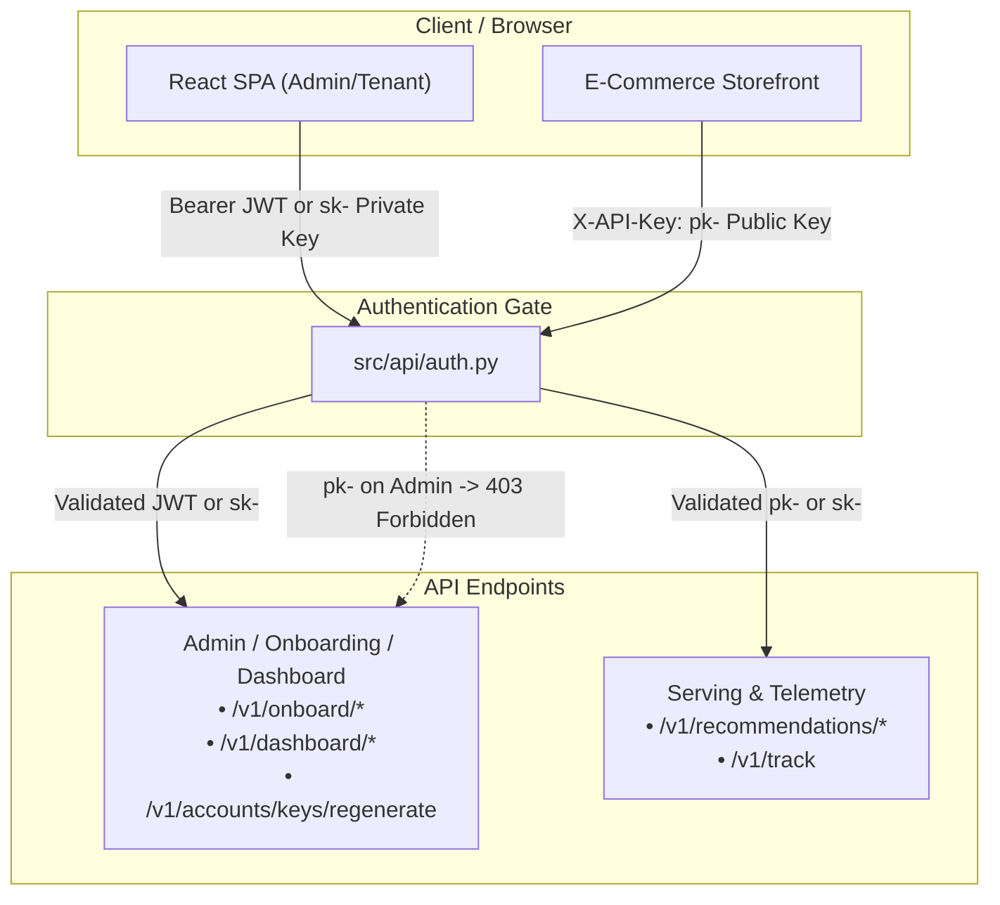
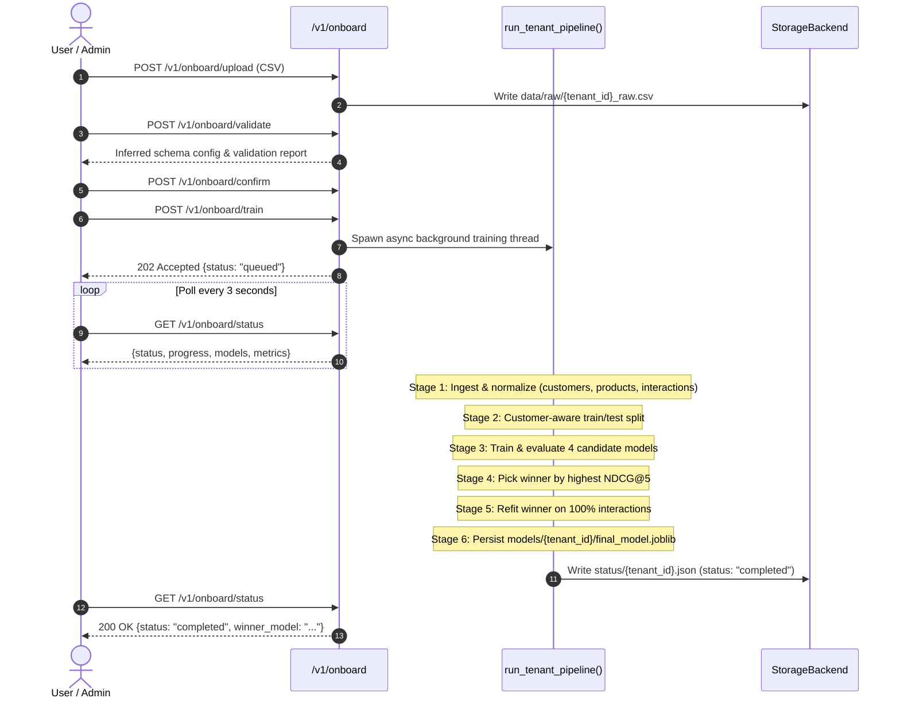

# AI_POD: Technical Architecture & System Reference

**Authoritative Technical Reference for AI_POD Multi-Tenant Recommendation Engine**  
*Document Version: 3.0 (Production Verified) | Date: November 2026*

---

## 1. System Overview

AI_POD is a production-ready, domain-agnostic, multi-tenant recommendation platform that decouples algorithmic recommendation models from proprietary schema semantics. Organizations and tenants onboard their datasets (e-commerce transactions, subscriptions, streaming interactions), run an automated 4-model competitive tournament, evaluate the models on holdout interactions, and serve personalized recommendations in real-time via low-latency REST APIs.

---

## 2. Authentication & Security Topology

AI_POD implements a hardened dual-layer authentication model separating administrative actions from client-side public telemetry and recommendation requests.

### 2.1 Administrative Authentication (`get_tenant_for_admin_action`)
All management and dashboard routes strictly require administrative identity:
1. **Bearer JWT Token**: Issued upon successful email/password login (`POST /v1/accounts/login`) and optional TOTP MFA (`POST /v1/accounts/login/mfa`). Token must be signed with `JWT_SECRET_KEY`, not expired, and `token_type != "mfa_challenge"`.
2. **Private API Key (`sk-...`)**: Passed via header `X-API-Key: sk-...`.
3. **Public Key Protection**: Public keys (`pk-...`) are strictly forbidden on administrative endpoints and return **HTTP 403 Forbidden**.
4. **Tenant Isolation**: The authenticated `tenant_id` is derived strictly from the verified JWT or secret key record. Passing arbitrary tenant identifiers in request parameters cannot access foreign tenant data.

### 2.2 Serving & Telemetry Authentication (`get_current_tenant`)
Recommendation queries (`/v1/recommendations/{customer_id}`) and telemetry events (`/v1/track`) authenticate via `X-API-Key`:
- Accepts public keys (`pk-...`) for safe inclusion in client-side storefronts and SDKs.
- Accepts private keys (`sk-...`) for server-to-server backend integrations.

### 2.3 Email Verification & Dev Backdoor
- **Signup Response Security**: `POST /v1/accounts/signup`, `POST /v1/accounts/resend-verification`, and `POST /v1/accounts/verify-email` never return verification codes, tokens, or private secrets in HTTP response bodies.
- **Dispatch**: Verification codes are sent via SMTP (or AWS SES in cloud). In local development where `SMTP_HOST` is unset, codes are logged to console and stored in memory (`RECENT_VERIFICATION_EMAILS`).
- **Dev Inspection Backdoor**: `GET /v1/accounts/dev/last-verification?email=...` returns the latest verification code for testing. In production environments (`ENV=production` or `AI_POD_ENV=production`), this endpoint returns **HTTP 404 Not Found**.
- **Brute-Force Account Lockout**: 5 consecutive failed verification or login attempts locks the targeted account for 15 minutes, returning **HTTP 423 Locked**.

---

## 3. Storage Abstraction & File Routing

AI_POD abstracts file persistence across local storage and Amazon S3 via `StorageBackend` (`src/storage/base.py`).

| Artifact Logical Path | Purpose | Format | Local Path | S3 Key |
| :--- | :--- | :--- | :--- | :--- |
| `data/raw/{tenant_id}_raw.csv` | Raw uploaded tabular dataset | CSV | `data/raw/{tenant_id}_raw.csv` | `data/raw/{tenant_id}_raw.csv` |
| `data/processed/{tenant_id}/customers.csv` | Canonical customers table | CSV | `data/processed/{tenant_id}/customers.csv` | `data/processed/{tenant_id}/customers.csv` |
| `data/processed/{tenant_id}/products.csv` | Canonical products table | CSV | `data/processed/{tenant_id}/products.csv` | `data/processed/{tenant_id}/products.csv` |
| `data/processed/{tenant_id}/interactions.csv` | Canonical interactions table | CSV | `data/processed/{tenant_id}/interactions.csv` | `data/processed/{tenant_id}/interactions.csv` |
| `models/{tenant_id}/final_model.joblib` | Serialized tournament winning model | Joblib | `models/{tenant_id}/final_model.joblib` | `models/{tenant_id}/final_model.joblib` |
| `status/{tenant_id}.json` | Real-time tournament training progress | JSON | `status/{tenant_id}.json` | `status/{tenant_id}.json` |
| `status/{tenant_id}_dataset_stats.json` | Cached dataset overview metrics | JSON | `status/{tenant_id}_dataset_stats.json` | `status/{tenant_id}_dataset_stats.json` |
| `data/telemetry/{tenant_id}/events/YYYY/MM/DD/part-*.jsonl` | Batched user behavior tracking events | JSONL | `data/telemetry/{tenant_id}/events/...` | `data/telemetry/{tenant_id}/events/...` |
| `data/telemetry/{tenant_id}/recommendations/YYYY/MM/DD/part-*.jsonl` | Batched recommendation telemetry | JSONL | `data/telemetry/{tenant_id}/recommendations/...` | `data/telemetry/{tenant_id}/recommendations/...` |

### 3.1 Status Mutability Rule
`status/{tenant_id}.json` is owned exclusively by the training pipeline (`src/pipeline/run.py`). Dashboard endpoints querying dataset statistics compute and cache numbers in `status/{tenant_id}_dataset_stats.json` to prevent race conditions or state clobbering while a model is training.

### 3.2 Atomic YAML Configuration
Tenant registrations and API keys are stored in `config/config.yaml`, `config/accounts.local.yaml`, and `config/tenants_auth.local.yaml`. All file writes use `atomic_dump_yaml` (writing to a sibling `.tmp` file, flushing buffers, `os.fsync`, and atomic `os.replace`) protected by thread locks.

---

## 4. End-to-End Onboarding & Model Tournament

The onboarding process (`src/pipeline/run.py`) executes a fully automated, competitive model tournament without simulated delays or hardcoded results.

### 4.1 The 4 Tournament Candidates
1. **Content-Based (`ContentBasedRecommender`)**: Cosine similarity over customer demographic or interaction-derived behavioral feature profiles.
2. **Collaborative Filtering (`CollaborativeFilteringRecommender`)**: TruncatedSVD matrix factorization over customer-product interaction matrices.
3. **Dynamic Hybrid (`HybridRecommender`)**: Score-weighted combination of content similarity and latent collaborative factors.
4. **Learned Ranking (`LearnedRankingRecommender`)**: Supervised gradient-boosted decision trees (`XGBClassifier`) scoring candidate product pairs against customer context.

### 4.2 Autonomous Winner Selection
Each model is evaluated on holdout customer interactions using **NDCG@5**, **Precision@5**, and **Recall@5**. The candidate achieving the highest NDCG@5 is designated tournament winner, refit on 100% of available interactions, and saved to `models/{tenant_id}/final_model.joblib`.

---

## 5. Dashboard & Telemetry Architecture

AI_POD provides 4 dedicated dashboard endpoints under `/v1/dashboard/`:

1. **`GET /v1/dashboard/overview`**: Returns operational health, winning model name, holdout metrics, today's request count, and dataset cardinality (cached in `status/{tenant_id}_dataset_stats.json`).
2. **`GET /v1/dashboard/analytics?days=7`**: Returns aggregated tracking event counts, recommendation counts, daily breakdowns, and event type distributions. Excludes test traffic carrying header `X-AIPOD-Source: wizard-test`.
3. **`GET /v1/dashboard/events?limit=20`**: Returns the latest raw behavioral tracking events (views, cart additions, purchases).
4. **`GET /v1/dashboard/models`**: Returns the complete tournament leaderboard with status, NDCG@5, Precision@5, and Recall@5 for all 4 algorithmic models.

### 5.1 Telemetry Buffering & S3 Layout
- Real-time events sent to `POST /v1/track` and recommendations served via `GET /v1/recommendations/{customer_id}` are queued in an in-memory buffer (`TelemetryCollector`).
- A background worker flushes buffers every 5 seconds to disk/S3 in partitioned JSON Lines format:
  `data/telemetry/{tenant_id}/events/YYYY/MM/DD/part-{timestamp}-{uuid}.jsonl`
  `data/telemetry/{tenant_id}/recommendations/YYYY/MM/DD/part-{timestamp}-{uuid}.jsonl`

---

## 6. Cold-Start Fallback Behavior

Recommendations queried via `GET /v1/recommendations/{customer_id}` follow a deterministic fallback policy:
- **Known Customer & Fitted Model**: Returns personalized recommendations with `"fallback": false`.
- **Unknown Customer**: Returns HTTP 200 with popularity-based fallback recommendations, `"fallback": true`, and `"reason": "unknown_customer"`.
- **Untrained Tenant**: Returns HTTP 200 with popularity-based recommendations, `"fallback": true`, and `"reason": "model_not_trained"`.
- **Missing or Invalid API Key**: Returns HTTP 401 Unauthorized.
- **Foreign Tenant Access**: Returns HTTP 403 Forbidden.

